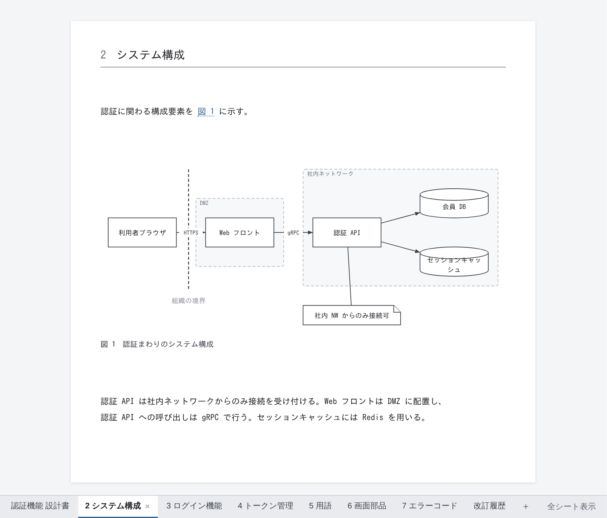

# DocPresenter

設計書を Markdown とテキスト形式の図・表で書き、Git の差分でレビューできるようにするツール。
画面上で図形を動かしたり表のセルを直したりしても、ファイルに書き戻されるのは変更した箇所だけである。



## 概要

Excel 方眼紙や Word、draw.io で作った設計書は、差分を取っても何が変わったのかを読み取れない。
人がレビューするのも、AI に読ませるのも難しい。

DocPresenter では、設計書をテキストファイルの集まりとしてリポジトリで管理する。
執筆、検証、配布、レビューの取り込みまでをこのリポジトリのツールで行う。
原本は常にソースファイルで、HTML / PDF / PPTX はそこからビルドのたびに生成する。

### リポジトリに置くファイル

```
docs/
  auth-design.md          本文（Markdown）。`@import` で図や表を取り込み、`---` で改ページする
  auth-design/            この文書でだけ使う図と表
    login-flow.dgm        図。図形と矢印を書けば配置は自動で決まり、手で動かした位置だけが記録される
    screen-items.table    結合セルのある表
    login-sequence.mmd    Mermaid で書いたシーケンス図
shared/                   複数の文書で共有する図・表・用語集
reviews/*.review.yml      顧客レビューの指摘と回答
```

どのファイルもそのまま読める形式なので、1 行直せば差分も 1 行で済む。
実際の構成は [`sample/`](sample/README.md) で確認できる。

### できること

| | |
|---|---|
| **編集** | VS Code または Web 画面で、本文・図・表を見た目のまま編集できる。図形を動かしても表のセルを直しても、ファイルに書き戻されるのは変更した箇所だけで、それ以外の行は一切変わらない。元に戻す操作や未保存の表示は VS Code の機能がそのまま使える |
| **採番と参照** | 図・表・章に番号を振り、`@fig-…` のような参照を「図 3」などに置き換える。目次と表紙も生成する。番号はソースに書かないため、図を 1 つ追加しても無関係な行に差分が出ない |
| **出力** | 文書ごとに **HTML / PDF / PPTX** を `out/build` に出力する。PDF にはフォントを埋め込み、長い表は複数ページに分割し、指定した表は横向きのページに配置する。PPTX の図と表は、PowerPoint で編集できる図形と表として出力する |
| **検証** | 参照切れ、どの出力にも含まれていないファイル、図や表の記述ミスを、出力せずに `パス:行:列` の形式で一覧にする。エラーがあると終了コード 1 で終わるため、CI でのチェックにも使える |
| **変更箇所の表示** | コミット・タグ・ブランチ・別フォルダのいずれかと比較し、変更された箇所に印を付けて出力する。変更箇所を手作業で色付けする必要はない |
| **PowerPoint からの反映** | 出力した PPTX 上で図形を動かしたり文字を直したりした場合、その変更だけを元の `.dgm` に反映できる |
| **レビューの取り込み** | Git を使わない顧客には、PDF に注釈を書いてもらうだけで済む。注釈は `reviews/*.review.yml` に取り込み、回答を載せた PDF を再び渡せる。指摘はソース上の位置と引用文で記録するため、文書の版が進んでも該当箇所を追跡できる |

ビルドがソースファイルを書き換えることはない。ソースが書き換わるのは、画面での編集、
PowerPoint からの反映、レビューの取り込みを利用者が実行したときだけである。

### 対象外としていること

- 既存の Excel・Word の設計書の取り込み。新たに Markdown で設計書を書き始めるチームを対象としている。
- Word / Excel 形式での出力。配布用の形式は PDF と PPTX で十分と判断した。
- ER 図の作図。ER 図は [ErCreator](https://github.com/Rintaro-Sugishita/ErCreator-releases) などの専用ツールで作成し、そのファイルを取り込む。

## パッケージ

[分割の理由と境界は packaging.md](design/packaging.md)。依存は一方向に流れる。

| パッケージ | 中身 | 単独公開 |
|---|---|:--:|
| `packages/base` | バイト範囲・編集・inline 記法・共通 UI 部品・表示言語の仕組み（日英） | 土台 |
| `packages/diagram` | 作図：記法・レイアウト・SVG 描画・部品ライブラリ・キャンバス GUI | **する** |
| `packages/markdown` | 文書エンジン：Markdown・表・採番・HTML 描画（画面を持たない） | **する** |
| `packages/pdf` | PDF：ページ計画・組版済み DOM の読み取り・改ページ・書き出し | 製品の一部 |
| `packages/pptx` | PPTX：デッキ・DrawingML・書庫 | 製品の一部 |
| `packages/build` | ビルド：ルート探索・参照閉包・診断・成果物の書き出し | 製品の一部 |
| `packages/editor` | 設計書の編集 UI：シート・本文ブロック・表のグリッド | 製品の一部 |
| `packages/app-vscode` | VS Code 拡張：カスタムエディタ・ビルドのコマンド | 製品の一部 |
| `packages/app-web` | Web の閲覧ページ：リポジトリの URL やこの PC のフォルダを開いて組版のまま読む・PDF を出す（サーバ無し） | 製品の一部 |

## 動かす

Node 22 以上。**PDF を書くときだけ**、この機械の Chromium 系ブラウザ（Chrome / Edge /
Chromium のどれか）と日本語フォントを使う——組版はブラウザにさせ、字は PDF に埋め込む
ためである。どちらも既定の置き場所を順に探し、見つからなければ**どこを探したかを言って
HTML と PPTX だけを書く**（黙って PDF を落とさない）。別の場所にあるなら名前で渡す。

```
node tools/build.mjs --in sample --chromium "C:\Program Files\Google\Chrome\Application\chrome.exe"
node tools/build.mjs --in sample --font "C:\Windows\Fonts\YuGothR.ttc"
# 環境変数 DOCPRESENTER_CHROMIUM / DOCPRESENTER_FONT でも同じ
```

```
npm install
npm test                        # 単体テスト
npx tsc --build                 # 型検査とビルド

node tools/build-editor-demo.mjs   # 設計書の編集画面   → out/editor.html（PDF のボタン付き）
node tools/build-canvas-demo.mjs   # 作図だけのページ   → out/canvas-app.html
node tools/build.mjs --in sample   # サンプルをビルド     → out/build/*.{html,pdf,pptx}
                                  #   長い表はページをまたぎ、`{page="landscape"}` の表は横向きのページになる
node tools/build.mjs --in sample --diff-from HEAD~3   # 前の版からの変更に印を付ける
node tools/check.mjs --in sample   # 書き出さずに全部確かめる（エラーがあれば終了コード 1、--strict なら警告でも）
node tools/pptx-back.mjs out/build/auth-overview.pptx --in sample   # 直された図を読み戻す

node tools/build-vscode.mjs        # VS Code 拡張             → packages/app-vscode/media/
node tools/build-web-viewer.mjs    # Web の閲覧ページ         → out/web/（GitHub Pages に置ける）

node tools/check-spec.mjs          # 仕様と実装が一致しているか
for f in tools/check-*.mjs; do node "$f"; done   # 全検証（上の 3 つを先に走らせておく）
```

## 表示言語

UI は日本語と英語。[決め方は決定事項 §9.4](design/decisions.md)。

- **VS Code** — VS Code の表示言語に従う（日本語以外は英語）。
- **Web 版**（`out/editor.html`・`out/canvas-app.html`）— 初めて開いたときに一度だけ尋ね、この端末に覚える。
  設定パネルの「表示言語 / Language」で変えられる。`?lang=en` を付けるとその回だけ英語で開く。
- **CLI** — `node tools/build.mjs --lang en`。無ければこの機械の言語設定から決める。

表紙の見出し・目次・「図 1 / Figure 1」など**成果物に入る文言も、ビルドした人の言語になる**。
CI で成果物の言語を揃えたいときは `--lang` で固定する。

文言を足すときは、そのパッケージの `src/messages.ts` に日本語と英語を並べて書く。
英語が抜けていればテスト（`checkMessages`）が落ちる。

## VS Code で使う

```
npx tsc --build && node tools/build-vscode.mjs
cd packages/app-vscode && npx @vscode/vsce package --no-dependencies
code --install-extension docpresenter-0.1.0.vsix
```

新しいリポジトリでは「DocPresenter: 作業場を初期化する」で、推奨のフォルダ・最初の文書・エージェント向けの書き方の仕様書（`.docpresenter/guide.md`）が揃う。
`.md` を開いて「DocPresenter: この文書を開く」。編集は **1 操作 ＝ 1 つのバイト範囲**の
`WorkspaceEdit` として渡すので、**取り消し・未保存の点・git の差分は VS Code のものがそのまま効く**。
開発中はリポジトリを VS Code で開いて **F5**（起動の前に `npm run build:vscode` が走る）。
開いた文書の上にある **「書き出し: HTML / PDF / PPTX」** のボタンで、その文書を `out/build` に書き出せる。
`output:` を持つ文書をまとめて書き出すコマンド（各文書の指定どおり／形式を選んで）もある。
エクスプローラーで `.md`・`.dgm` を右クリックすると「DocPresenter で開く」が出る。
コードブロックは言語名で色が付き、` ```mermaid ` は図になる（見本は
[`sample/docs/code-and-mermaid.md`](sample/docs/code-and-mermaid.md)）。詳しくは
[`packages/app-vscode/README.md`](packages/app-vscode/README.md)。

`out/canvas-app.html` は base ＋ diagram だけで作られている。文書エンジンは 1 バイトも入っていない
（`out/canvas/index.html` はそれを 1 枚に畳んだもの）。

## 仕様

`.dgm` と `.table` の仕様は **英語で [`spec/`](spec/README.md) にあります**。
この 2 つの形式は[ライセンスの対象外](legal/LICENSE.draft.md)で、**誰がどの言語で実装しても構いません**。

| | |
|---|---|
| [`spec/dgm.md`](spec/dgm.md) | 作図：図形・接続・手で置いた位置・スタイル |
| [`spec/table.md`](spec/table.md) | 表：結合セル・ブロック・名前付き範囲・スタイル |
| [`spec/inline-text.md`](spec/inline-text.md) | ラベルとセルの中で使える書式 |

## ライセンス

**ソースは公開していますが、オープンソースではありません。**
再配布は自由、改変は許諾していません（ビルド・バンドル・最小化は改変に当たりません）。

| | |
|---|---|
| [`legal/LICENSE.draft.md`](legal/LICENSE.draft.md) | 条文のドラフト。**まだ効力を持ちません**（法務確認前） |
| [`legal/CLA.draft.md`](legal/CLA.draft.md) | 貢献の許諾のドラフト。著作権は貢献者が持ったままです |
| [design/licensing.md](design/licensing.md) | 方針とその理由 |
| [CONTRIBUTING.md](CONTRIBUTING.md) | 報告と PR の手順 |

## 設計

決定事項は [design/decisions.md](design/decisions.md) に集約してある。未実装の一覧は
[design/backlog.md](design/backlog.md)、まだ決めていないことは [design/open-issues.md](design/open-issues.md)。
