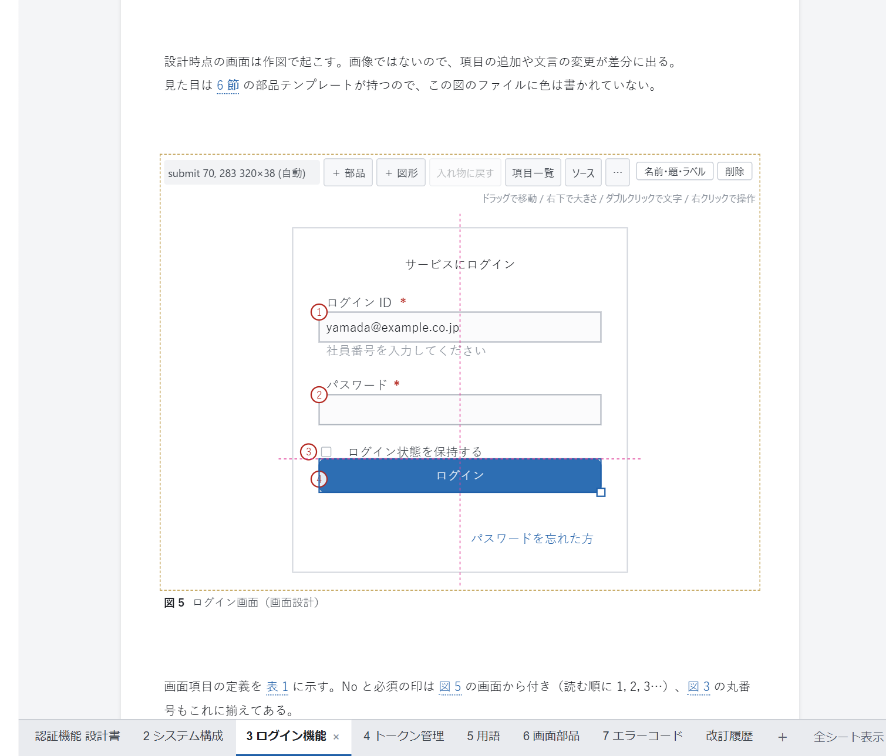
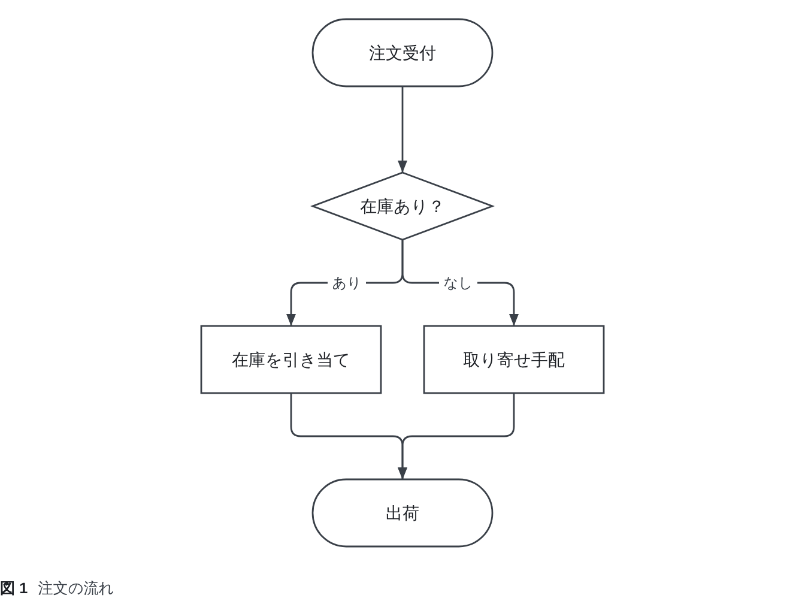
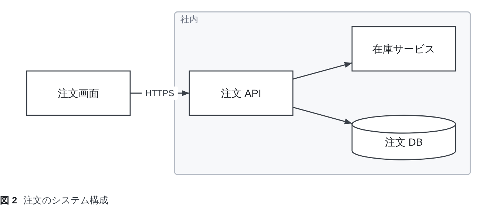

# DocPresenter Diagram（VS Code 拡張）

[English](https://github.com/Rintaro-Sugishita/DocPresenter/blob/HEAD/packages/app-vscode-diagram/README.md)

図を**テキストでも、キャンバス上でも**描ける拡張機能。矢印のつながりから自動で配置するフローチャートと、PowerPoint のように
置いた位置のまま描く図（構成図・画面の見取り図・画面キャプチャへの注釈）の両方を扱う。図は `.dgm` のテキストファイルなので、
どの変更も読める Git の差分になり、キャンバスでの操作も変えた行だけを書き換える。



設計書の拡張機能 [DocPresenter](https://github.com/Rintaro-Sugishita/DocPresenter/blob/HEAD/packages/app-vscode/README.ja.md)
と一緒に入る。図を文書に取り込み、HTML・PDF・PowerPoint に書き出すのはそちらの役目である。この拡張機能だけでも使える。

## 2 種類の図

**flow**：図形とつながりを書けば、配置は自動で決まる。

```
flow {
  start   ([注文受付])
  check   {在庫あり？}
  reserve [在庫を引き当て]
  backord [取り寄せ手配]
  ship    ([出荷])

  start   --> check
  check   --> reserve "あり"
  check   --> backord "なし"
  reserve --> ship
  backord --> ship
}
```



**free**：図形を置いた位置をそのまま保つ。位置は別の `layout` セクションに書かれるので、図形を動かしても変わるのは
そこの 1 行だけで、図の中身を表す行は変わらない。



## キャンバスで描く

エクスプローラーで `.dgm` を右クリックして **「DocPresenter Diagram で開く」** を選ぶ。テキストを開いているときに
**Ctrl+K V** を押すと、テキストの横にキャンバスが開く。

- 図形をドラッグで移動し、右下のハンドルで大きさを変える。ほかの図形の端や中心に合わせたガイド線に吸着する。
- ダブルクリックで文字を直す。「＋ 図形」で図形を、「＋ 部品」でルータやサーバなどのアイコンや、ボタン・入力欄などの
  画面部品を追加する。
- 右クリックのメニューから、線を引く・グループにする・削除する・自動配置に戻す、などの操作ができる。複数の図形を選んで
  そろえたり等間隔に並べたりでき、線は途中をドラッグして曲げられる。
- どの操作も、ファイル上の **1 つのバイト範囲の置き換え**として VS Code の `WorkspaceEdit` で書き戻す。元に戻す操作・
  未保存の表示・Git の差分は VS Code のものがそのまま使え、横に開いたテキストもドラッグに合わせて変わる。
- **「ソース」** でテキストを横に開く。書きかけなどでテキストが読めない間は、キャンバスは直前の絵を残し、何が読めないかを表示する。

## `.dgm` をテキストで書く

「DocPresenter Diagram で開く」を使わずに通常のテキストとして `.dgm` を開くと、記述の種類ごとに色分けされ、入力に合わせて候補が表示される。

- **ファイルの最上位**：セクション（`flow` / `free` / `overlay` / `layout` / `style` / `parts`）と `use "…"`。`use` の引用符の中では、
  `default`・`icons` と、作業場にある部品ファイル（この図からの相対パス）が候補に出る。
- **図形の ID の後ろ**：12 種類の括弧（`[ ]`・`([ ])`・`[( )]` など）、読み込んでいる部品ライブラリの部品（`textbox:` など）、接続記号。
  **接続記号の後ろ**：その図形からまだ接続していない図形。
- **`layout` セクション**：まだ位置を指定していない図形、まだ折れ点のない線、コンテナ（`stack` / `grid` / `tabs`）とその設定・中身。
- **`style` セクション**：まだ見た目を指定していない図形、プロパティ（`fill`・`line`・`icon` など）とその値（`dashed`・`net/router` など）。

`#` で始まる行はコメントになる（Ctrl+/ で切り替えられる）。最上位に書かれた解釈できない行は、形式上のエラーとして赤く表示される。

## 整形する

手で書いた図は、コマンド **「DocPresenter Diagram: 図を整形する」**（コマンドパレット、またはエクスプローラーで `.dgm` を右クリック）か、
VS Code の **「ドキュメントのフォーマット」**（Shift+Alt+F）で、決まった形に整えられる。

- **同じ図なら、同じ文になる。** 行の並びは、書いた順ではなく図から決まる。入れ物の中身は入れ物の直後に並びの順で、
  それ以外は矢印の流れに沿って、残りは読み順（上から下、左から右）で並ぶ。ピンやスタイルの行も、対応する図形の順に並ぶ。
  そのため、誰が書いても整形すれば同じファイルになる。
- 空白と書き方もそろう。id や数値は列をそろえ、`->` は `-->` に、入れ物の設定は既定と違うものだけを書く。
  コメントは、すぐ下の行と一緒に移動する。
- **図そのものは変わらない。** 整形した結果を読み直し、箱の位置・線の経路・重なった図形の前後を元と比べる。
  読み順に並べると図形が動いてしまう場合は、図形を書かれた順のまま残し、その旨を通知する。
- コマンドは整形後に保存する（未保存の変更があったファイルは保存しない）。「ドキュメントのフォーマット」は保存しない。
- 規則は [spec/dgm.md §6.3](https://github.com/Rintaro-Sugishita/DocPresenter/blob/HEAD/spec/dgm.md) にある。

## SVG に書き出す

**「DocPresenter Diagram: 図を SVG に書き出す…」**（コマンドパレット、エディタの「…」メニュー、または `.dgm` の右クリック）で、
図を SVG ファイルとして保存する。保存先には、図と同じフォルダ・同じ名前が最初に示される。テーマの図の規則をファイルの中に入れ、
部品がパスで指す絵も埋め込むので、ブラウザや画像ビューア、Office のソフトで開いても同じ見た目になる。

## 形式

`.dgm` の形式は [spec/dgm.md](https://github.com/Rintaro-Sugishita/DocPresenter/blob/HEAD/spec/dgm.md) に定めてあり、
誰が実装してもよい。id に使えるのは英数字・`_`・かな漢字で、ハイフンは使えない（接続の記号と紛れるため）。そのため `a-->b` は、
空白がなくても必ず `a` から `b` への線と読める。

## 表示言語

VS Code の表示言語に従う。VS Code が日本語なら日本語、それ以外なら英語で表示される。

## 既知の不具合

分かっていて、まだ直していない不具合は [KNOWN-ISSUES.md](https://github.com/Rintaro-Sugishita/DocPresenter/blob/HEAD/KNOWN-ISSUES.md) に載せている。
大事な作業に使う前に確認してほしい。

## ライセンス

DocPresenter の著作権は Rintaro Sugishita にある。商用を含めて無償で使え、そのまま再配布できる。改変は許諾していない。
無保証で、作者は損害を賠償しない。条文は [LICENSE.md](https://github.com/Rintaro-Sugishita/DocPresenter/blob/HEAD/LICENSE.md)（英語が正文）。
