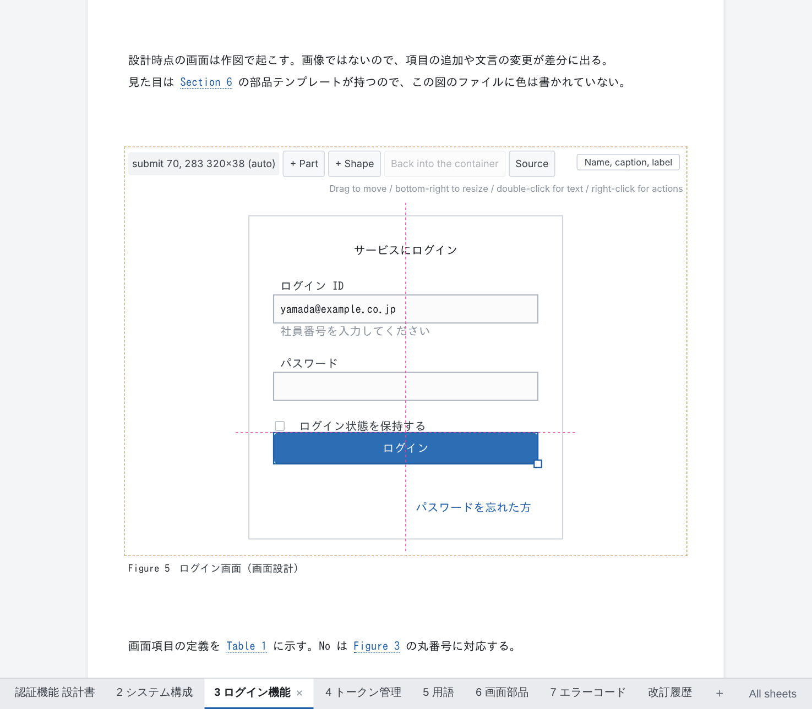
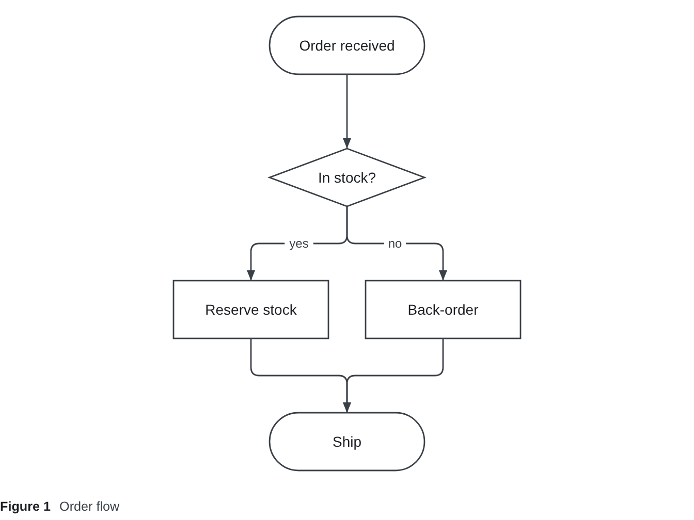
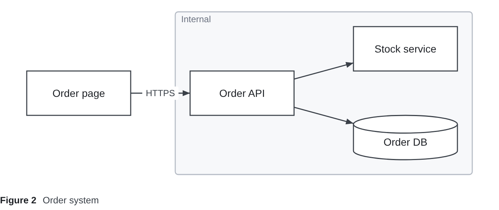

# DocPresenter Diagram (VS Code extension)

[日本語](https://github.com/Rintaro-Sugishita/DocPresenter/blob/HEAD/packages/app-vscode-diagram/README.ja.md)

Draw diagrams **as text or on a canvas** — flowcharts laid out from their arrows, and free-form drawings placed the
way you would in PowerPoint: system diagrams, screen sketches, annotated screenshots. A drawing is a `.dgm` text file,
so every change is a readable Git diff, and the canvas writes back only the lines it changes.



It comes with [DocPresenter](https://github.com/Rintaro-Sugishita/DocPresenter/blob/HEAD/packages/app-vscode/README.md),
the design-document extension, which takes drawings into documents and exports them to HTML, PDF and PowerPoint. It
also works on its own.

## Two kinds of drawing

**flow**: write the shapes and how they connect; the layout is worked out for you.

```
flow {
  start   ([Order received])
  check   {In stock?}
  reserve [Reserve stock]
  backord [Back-order]
  ship    ([Ship])

  start   --> check
  check   --> reserve "yes"
  check   --> backord "no"
  reserve --> ship
  backord --> ship
}
```



**free**: shapes stay where you put them. The positions are in a `layout` section of their own, so moving a shape
changes one line there and nothing in what the drawing says.



## On the canvas

Right-click a `.dgm` → **"Open in DocPresenter Diagram"**, or press **Ctrl+K V** in the text to open the canvas beside it.

- Drag shapes to move them and the bottom-right handle to resize; they snap to guides lined up with other shapes.
- Double-click to change text. "+ Shape" adds shapes; "+ Part" adds icons such as routers and servers, and screen parts
  such as buttons and inputs.
- Right-click to draw a line, group, delete, or hand a shape back to the automatic layout. Pick several shapes to line
  them up or spread them evenly; drag the middle of a line to bend it.
- Every gesture is written back as **one byte range** of the file, handed to VS Code as a `WorkspaceEdit`: undo, the
  unsaved dot and the Git diff are VS Code's own, and the text beside the canvas changes as you drag.
- **"Source"** shows the text beside the canvas. While the text cannot be read (half typed), the canvas keeps the last
  picture and says what is wrong.

## Writing a `.dgm` as text

Opened as text (the usual way, without "Open in DocPresenter Diagram"), a `.dgm` is coloured by layer and offers suggestions as you type:

- **At the top**: the sections (`flow` / `free` / `overlay` / `layout` / `style` / `parts`) and `use "…"`. Inside the quotes
  of `use`: `default`, `icons`, and the workspace's files of parts, written relative to this drawing.
- **After a shape's id**: the twelve bracket pairs (`[ ]`, `([ ])`, `[( )]` …), the parts the drawing's libraries declare
  (`textbox:` …), and the connectors. **After a connector**: the shapes not yet joined from that one.
- **In `layout`**: the shapes with no pin yet, the connections with no corner yet, and the containers (`stack` / `grid` / `tabs`)
  with their settings and contents.
- **In `style`**: the shapes with no rule yet, the properties (`fill`, `line`, `icon` …) and their values (`dashed`, `net/router` …).

`#` comments the line (Ctrl+/), and errors at the top level are shown in red, as the format refuses them.

## Formatting

A drawing typed by hand can be put into its canonical form with **"DocPresenter Diagram: Format This Diagram"** (in the
Command Palette, or right-click a `.dgm` in the Explorer) or VS Code's own **"Format Document"** (Shift+Alt+F).

- **One drawing, one text.** The lines are put in an order taken from the drawing, not from the order they were
  typed: what a container holds after the container, everything else along the arrows, and the rest in reading
  order. Pins and style rules follow their shapes. So two people who draw the same thing get the same file.
- Spacing and spelling are made uniform: ids and numbers lined up in columns, `->` written `-->`, container settings
  written only where they differ from the default. A comment moves with the line below it.
- **The drawing never changes.** The result is read back and compared with the original — every box, every line's
  route, which of two overlapping shapes is in front. Where reading order would move a shape, the shapes keep the
  order they were written in, and a notification says so.
- The command saves the drawing (unless it had unsaved changes); "Format Document" leaves saving to you.
- The rules are in [spec/dgm.md §6.3](https://github.com/Rintaro-Sugishita/DocPresenter/blob/HEAD/spec/dgm.md).

## Exporting SVG

**"DocPresenter Diagram: Export This Diagram as SVG…"** (Command Palette, the editor's "…" menu, or right-click a
`.dgm`) saves the drawing as an SVG file, offering the drawing's own folder and name. The theme's drawing rules go
inside the file, and pictures a part points at by path are embedded, so it looks the same in a browser, an image
viewer or an office program.

## The format

The `.dgm` format is specified in [spec/dgm.md](https://github.com/Rintaro-Sugishita/DocPresenter/blob/HEAD/spec/dgm.md)
and free for anyone to implement. Ids are letters, digits, `_` and kana/kanji — no hyphen, which connectors are made
of, so `a-->b` always reads as a connection from `a` to `b`.

## Display language

It follows VS Code's display language: Japanese when VS Code is in Japanese, English otherwise. This page is in
English whatever the display language; the Japanese version is linked at the top.

## Known issues

Defects we know about and have not fixed yet are listed in
[KNOWN-ISSUES.md](https://github.com/Rintaro-Sugishita/DocPresenter/blob/HEAD/KNOWN-ISSUES.md). Please read it before relying on the extension for important work.

## Licence

DocPresenter is Copyright © 2026 Rintaro Sugishita. It is free to use, including commercially, and to pass on unchanged;
changing it is not permitted. It comes as is, with no warranty and no liability. The terms are in
[LICENSE.md](https://github.com/Rintaro-Sugishita/DocPresenter/blob/HEAD/LICENSE.md).
