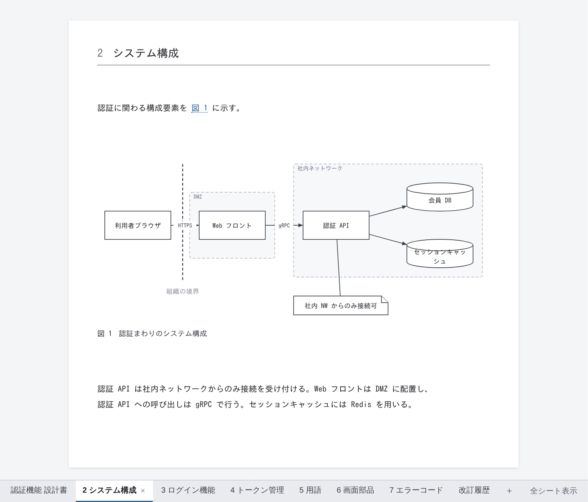
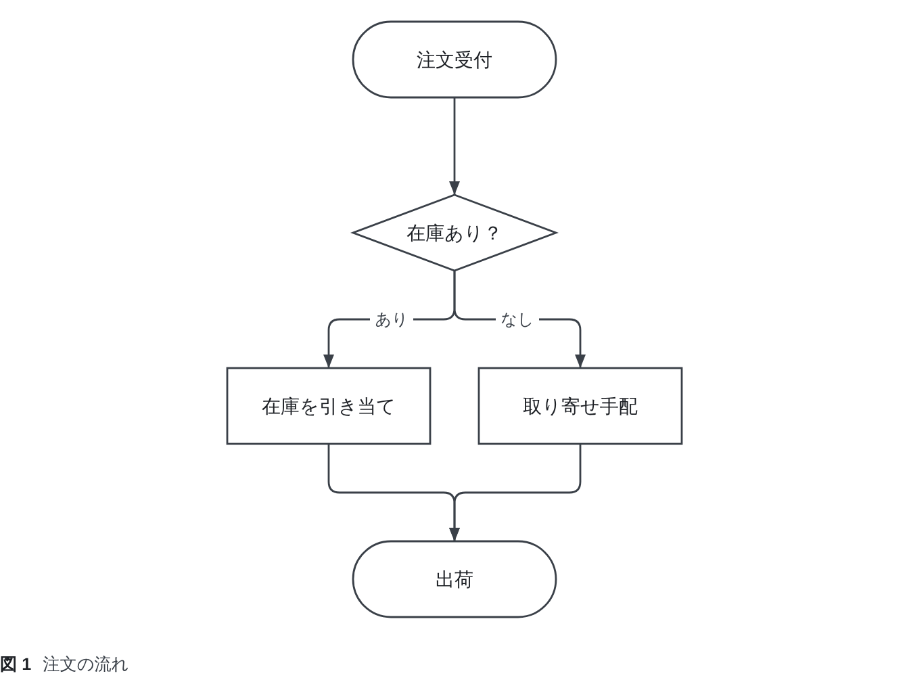
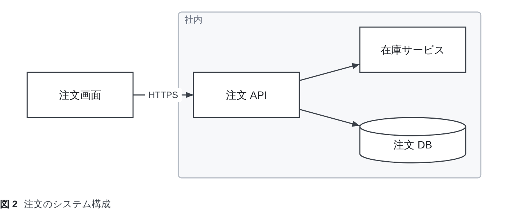
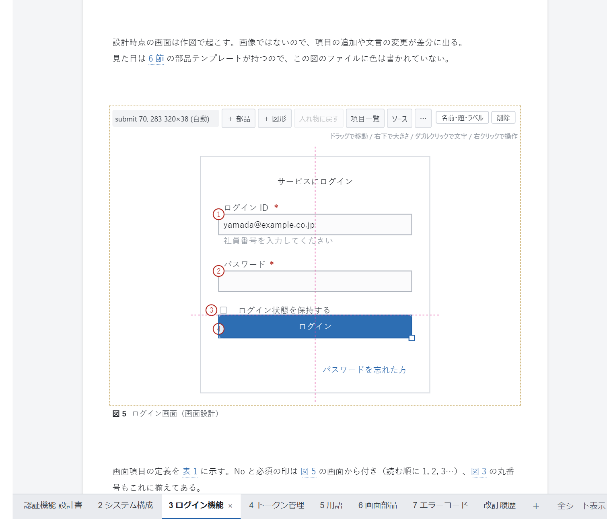
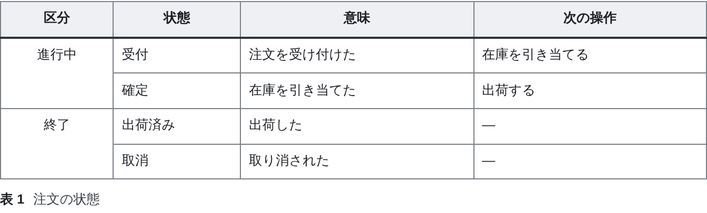
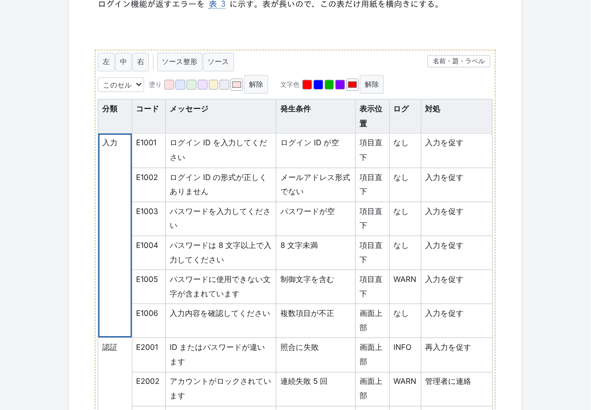

# DocPresenter（VS Code 拡張）

[English](https://github.com/Rintaro-Sugishita/DocPresenter/blob/HEAD/packages/app-vscode/README.md)

設計書の本文を Markdown で、図と表をテキスト形式のファイルで書き、VS Code の中で**印刷時と同じページの形のまま**編集できる拡張機能。
**HTML・PDF・PowerPoint（PPTX）**に出力でき、PPTX の図と表は PowerPoint 上でも編集できる。どの変更も通常の Git の差分としてレビューできる。

DocPresenter を入れると、作図の拡張機能 **DocPresenter Diagram** も一緒に入る。`.dgm` ファイル単体をテキストやキャンバスで描き、
SVG に書き出すのはそちらの役目である。文書の中の図は、DocPresenter 自身が描き、その場で編集できる。



## 概要

Excel・Word・draw.io で作った設計書は、プルリクエストでのレビューに向かない。差分を取っても、
何が変わったのかを人も AI も読み取れないためである。

DocPresenter は、設計書をリポジトリ内のテキストファイルとして扱ったうえで、次の機能を提供する。

| | |
|---|---|
| **見た目のまま編集** | `.md` を開くと、印刷時と同じページの形で表示される。そのまま文章を入力し、図形を動かし、表のセルを直せる。1 回の操作は**ファイル上の 1 か所の小さな変更**として書き戻されるため、Git の差分には直した箇所だけが現れる |
| **作図** | フロー図・状態遷移図・構成図・画面の見取り図などを、`.dgm` 形式のテキストファイルで描く。図形と矢印を書けば配置は自動で決まり、手で動かした位置だけが記録される |
| **採番と相互参照** | 図・表・見出しに番号を振り、`@fig-login` のような参照を「図 3」などに置き換える。目次と表紙も生成する |
| **出力** | ボタン 1 つで HTML・PDF（フォント埋め込み）・PPTX（図と表は PowerPoint で編集可能）を出力する |
| **検証** | 参照切れや図・表の記述ミスを「問題」パネルに表示する |
| **PowerPoint からの反映** | 出力した PPTX 上で動かした図形や直した文字を、元の `.dgm` に反映できる |
| **Git を使わない人からのレビュー** | 顧客には、いつもどおり PDF に注釈を書いてもらうだけでよい。注釈はレビューファイルに取り込まれ、注釈を付けた文言そのものに結び付けて記録される。回答は次に出力する PDF に載せて返せる |

## 図と表は、コードでも画面でも編集できる

図（`.dgm`）と表（`.table`）は、**テキストで書くことも、画面上でマウスを使って編集することもできる**。
どちらで編集しても保存先は同じ 1 つのテキストファイルで、画面での操作は変更した行だけを書き換える。
テキストで書きたい人と画面で編集したい人が、同じファイルをそのまま共同で扱える。

### 図：フローチャートも、PowerPoint のような自由配置の図も

`.dgm` には 2 種類の描き方がある。

**flow**：図形とつながりを書けば、配置は自動で決まる。処理の流れ・手順・状態遷移に向く。

```
flow {
  start   ([注文受付])
  check   {在庫あり？}
  reserve [在庫を引き当て]
  backord [取り寄せ手配]
  ship    ([出荷])

  start   --> check
  check   --> reserve "あり"
  check   --> backord "なし"
  reserve --> ship
  backord --> ship
}
```



**free**：図形を置いた位置をそのまま保つ。PowerPoint で描くような構成図や画面の見取り図に向く。

```
free {
  shop  [注文画面]
  api   [注文 API]
  stock [在庫サービス]
  db    [(注文 DB)]

  group back "社内" { api; stock; db }

  shop  -> api   "HTTPS"
  api   -> stock
  api   -> db
}

layout {
  shop  @ ( 40, 100) 140x60
  api   @ (260, 100) 140x60
  stock @ (480,  40) 140x60
  db    @ (480, 160) 140x60
  back  @ (240,  20) 400x220  z:-1
}
```



**画面で描く**（文書の中で、または `.dgm` 単体なら「DocPresenter Diagram で開く」）



- 図形をドラッグで移動し、右下のハンドルで大きさを変える。ほかの図形の端や中心に合わせたガイド線に吸着する。
- ダブルクリックで文字を直す。「＋ 図形」で図形を、「＋ 部品」でルータやサーバなどのアイコンや、ボタン・入力欄などの画面部品を追加する。
- 右クリックのメニューから、線を引く・グループにする・削除する・自動配置に戻す、などの操作ができる。
- 複数の図形を選んで、端や中心をそろえたり、等間隔に並べたりできる。
- 線は途中をドラッグして曲げ、端をドラッグしてつなぎ先を変える。矢印の向きと線の太さも選べる。
- flow の図では、手で動かした図形の位置だけが記録され、ほかの図形は自動配置のまま残る。

**コードで書く**（テキストとして開く）

- VS Code で `.dgm` をテキストとして開くと、記述の種類ごとに色分けされ、図形の形・部品・接続先・プロパティなどの入力候補が出る。
- 書き間違いは赤く表示され、「問題」パネルにも並ぶ。
- 1 つの図形が 1 行なので、差分を見れば何が変わったかがそのまま分かる。
- 形式の[仕様](https://github.com/Rintaro-Sugishita/DocPresenter/blob/HEAD/spec/dgm.md)は公開しており、Claude Code などの AI エージェントにも書かせられる。
- 出力した PowerPoint で図形を動かした場合も、その変更を `.dgm` に反映できる。

### 表：独自形式のテキストと、Excel のようなグリッド編集

Markdown の表では足りない表（結合セル・列幅・色分けが必要な表）は、`.table` で書く。

```
| 区分   | 状態     | 意味             | 次の操作         |
|:------:|----------|------------------|------------------|
| 進行中 | 受付     | 注文を受け付けた | 在庫を引き当てる |
| ^      | 確定     | 在庫を引き当てた | 出荷する         |
| 終了   | 出荷済み | 出荷した         | —                |
| ^      | 取消     | 取り消された     | —                |

style {
  col:区分 { width: 16% }
  col:状態 { width: 18% }
}
```



**テキストの形式**

- 見た目は Markdown の表のままで、`^` と書けば上のセルと結合する。
- 列幅・塗り・文字色は、表の下の `style` に分けて書く。表の本体には混ざらないので、表としての読みやすさを保てる。
- セルの中に箇条書きを入れたり、範囲に名前を付けたりもできる。
- 1 つのセルを直せば、差分も 1 行で済む。[仕様](https://github.com/Rintaro-Sugishita/DocPresenter/blob/HEAD/spec/table.md)は公開している。

**画面で編集する**



- 表計算ソフトと同じ感覚で操作できる。クリックで選択し、矢印キーで移動し、そのまま入力すれば上書きになる。Enter や Tab で確定して次のセルに進む。
- Shift＋矢印キーやドラッグで範囲を選択できる。Excel やスプレッドシートとの間でコピー・貼り付けもできる。
- 右クリックから、行や列の追加・削除、セルの結合・解除ができる。
- 列の境目をドラッグして列幅を決める。セル・行・列・見出しを対象に、塗り・文字色・左右の寄せを設定できる。
- 「ソース整形」でテキストの桁をそろえ、「ソース」で `.table` を直接編集できる。

**Excel とのやり取りはクリップボードで**

Excel ファイル（.xlsx）の読み込みや書き出しはしない。代わりに、表計算ソフトとの間でセルをそのままコピー・貼り付けできる。

- **Excel → 表**：Excel や Google スプレッドシートで範囲をコピーし、表のセルを選んで貼り付ける。選んだセルを左上として値が入り、
  足りない行や列は増える。貼り付け全体が 1 回の編集になるので、元に戻すのも 1 回で済む。
- **表 → Excel**：表で範囲を選んでコピー（切り取り）すると、タブ区切りの文字としてクリップボードに入り、表計算ソフトにそのまま貼れる。
  見出し行も範囲に含められる。結合で覆われた位置は空のセルになる（値を複製しない）。
- セル内で改行したセル（Alt+Enter）や引用符を含むセルも、1 つのセルとして受け渡す。表のセルは 1 行なので、
  貼り付けた改行は空白になる。`|` は文字として `\|` で書き込まれる。
- 色や罫線などの書式は受け渡さない。値だけを移す。

## 扱うファイル

どのファイルも差分で読めるテキストであり、拡張機能がファイル以外の場所に状態を隠し持つことはない。

| ファイル | 内容 |
|---|---|
| `.md` | 文書本体。Markdown の先頭に短い frontmatter（文書番号 `document:`、`title:`、出力形式 `output:` など）を付ける。`@import "パス"` で図や表を取り込み、`---` で改ページする（PPTX では次のスライドになる） |
| `.dgm` | 図。図形と接続を 1 行ずつ書く（`login [ログイン]`、`login --> home`）。テキストとして開くと色分けと入力候補が出て、一緒に入る DocPresenter Diagram の「DocPresenter Diagram で開く」を使うとキャンバス上で描ける。[仕様](https://github.com/Rintaro-Sugishita/DocPresenter/blob/HEAD/spec/dgm.md) |
| `.table` | 結合セル・列幅・名前付き範囲を持つ表。Markdown の表では表現しきれないときに使い、文書の中でグリッドとして編集する。[仕様](https://github.com/Rintaro-Sugishita/DocPresenter/blob/HEAD/spec/table.md) |
| `.mmd` | Mermaid で書いた図（シーケンス図など）。`.md` の中に ` ```mermaid ` で直接書いてもよい |
| `.png` `.jpg` `.svg` など | 画像。図と同じく `@import` で取り込む |
| `reviews/*.review.yml` | レビューの指摘と回答。レビュー 1 回につき 1 ファイル |
| `.docpresenter/` | チームのテンプレート・テーマ・執筆ガイド（「作業場を初期化する」コマンドで作成される） |

標準的な配置は次のとおり。文書ごとに `docs/<名前>.md` を置き、その文書でだけ使う図と表は `docs/<名前>/` に、
複数の文書で共有するものは `shared/` に置く。

## はじめに

### 1. リポジトリを初期化する

まず、リポジトリごとに一度だけ、コマンド **「DocPresenter: 作業場を初期化する」** を実行する。題名・ファイル名・文書番号を
入力すると、次のファイルとフォルダが作成され、最初の文書が開く。**すでに存在するファイルは上書きしない**（そのまま残したことを報告する）。

```
docs/<ファイル名>.md            最初の文書（下記のテンプレートから作成）。frontmatter・概要・改訂履歴の取り込みまで記入済み
docs/<ファイル名>/revision.md   その文書の改訂履歴
docs/assets/                   画像の置き場所
shared/glossary.table          複数の文書から参照する用語集
.docpresenter/guide.md         執筆ガイド（Claude Code などの AI エージェント向け）
.docpresenter/spec/            .dgm・.table・ラベル内の書式の仕様
.docpresenter/templates/       新しい文書のテンプレート（document.md・revision.md）。チームの書式に合わせて編集してよい
.docpresenter/themes/default/  テーマ（theme.css）。拡張機能に同梱のテーマの複製で、チームのデザインに合わせて編集してよい
CLAUDE.md / AGENTS.md          guide.md を読むよう指示する節を追記（ファイルがなければ作成）
.gitignore                     出力先（out/）を追記
```

追記は一度しか行わないため、コマンドを再実行しても同じ内容が重複して追加されることはない。

### 2. 文書を追加する

文書を追加するには、コマンド **「DocPresenter: 新しい文書を作る」** を実行する（エクスプローラーでフォルダを右クリックしても選べる）。
題名・フォルダ・ファイル名を入力すると、文書番号が**自動で採番**され、テンプレート（`.docpresenter/templates/`、後述）から
文書と改訂履歴が作成される。番号は、リポジトリですでに使われている系列（`SD-AUTH-` など）の次の空き番号から選ばれる。
新しい系列や任意の番号も指定できるが、使用中の番号は指定できない。レビューの指摘は文書番号に結び付けて管理するため、
**文書番号は必須で、重複も許されない**（重複があるとビルド時に警告が出る）。

### 3. 図を追加する

図を追加するには、コマンド **「DocPresenter: 新しい図を作る」** を実行する（フォルダの右クリックからも選べる）。
最初に図の種類を選ぶ。

- **flow**：矢印のつながりから自動で配置する。処理の流れ・手順・状態遷移に向く。
- **free**：置いた位置をそのまま保つ。構成図や画面の見取り図に向く。

続いてフォルダ（各文書の図表フォルダ、図のあるフォルダ、`shared/` の順に候補が出る）と名前を指定すると、作成された図が開く。
図を文書に載せるには、文書の末尾にある「＋ 参照」から選ぶ。

### フォルダ分け

規模の大きいアプリケーションでは、設計書をフォルダに分けて管理できる（`docs/order/design.md`、`docs/billing/design.md` など）。

- 文書や図を作るときは、一覧からフォルダを選ぶか、別のフォルダ名を入力する（存在しなければ作成される）。
  名前に `/` を含めても、そのフォルダの中に作成できる（`order/design`）。
- ファイル名には大文字・空白・日本語も使える。使えないのは、いずれかの OS で扱えない名前だけである。
  具体的には `\ : * ? " < > |` を含む名前、先頭が空白の名前、末尾が空白またはピリオドの名前、
  Windows の予約名（`CON`、`NUL` など）が該当する。
- `@import` のパスは文書からの相対パスなので、文書をどの階層に置いても図表を参照できる。テンプレートの `{{root}}` は
  リポジトリ直下への相対パス（`docs/order/design.md` なら `../../`）に置き換わるため、`{{root}}shared/` は常に `shared/` を指す。
- **出力時もフォルダ構成は保たれる。** `docs/order/design.md` は `out/build/order/design.html` に出力される（`docs/` の階層は省かれる）。
  別のフォルダに同じ名前の文書があっても、互いに上書きされることはない。
- 文書番号の重複は、フォルダに関係なくリポジトリ全体で確認する。

### チームのテンプレートとテーマ

初期化で作成されるテンプレートとテーマは**リポジトリ内の通常のファイル**なので、チームで編集してコミットすればよい。

- **テンプレート**（`.docpresenter/templates/document.md`・`revision.md`）は、「新しい文書を作る」を実行するたびに使われる。
  差し込み項目は `{{title}}`（題名）、`{{number}}`（文書番号）、`{{name}}`（フォルダを除いたファイル名。改訂履歴の取り込みに使う）、
  `{{today}}`（今日の日付）、`{{root}}`（リポジトリ直下への相対パス）の 5 つ。frontmatter の値全体を差し込む場合は、
  YAML として正しい形で書き込まれる（`:` を含む題名は引用符で囲まれる）。
  テンプレートに `document:` がなくても、採番した番号は必ず frontmatter に入る。テンプレートのファイルがなければ、拡張機能に同梱のものを使う。
- **テーマ**は `.docpresenter/themes/<名前>/theme.css`、`themes/<名前>/theme.css`、拡張機能に同梱のテーマの順に探す
  （`<名前>` は frontmatter の `theme:` の値で、指定がなければ `default`）。見つかったテーマは出力（HTML・PDF）にも
  編集画面にも使われ、テーマを保存すると編集画面にすぐ反映される。

## 開く

- エクスプローラーで `.md` を右クリックし、**「DocPresenter で開く」** を選ぶ。エディタ右上のボタンからも開ける。
  文書はページ（シート）が並んだ画面で開き、図や表はその場で編集できる。
- `.dgm` 単体は、DocPresenter Diagram のキャンバスで開く。右クリックして **「DocPresenter Diagram で開く」** を選ぶ。
- 編集内容は、**1 回の操作につきファイル上の 1 か所（1 つのバイト範囲）の置き換え**として書き戻される。
  編集を VS Code の `WorkspaceEdit` として渡しているため、VS Code の元に戻す操作・未保存の表示・Git の差分がそのまま使える。
- 画面上では **Ctrl+Z で元に戻し、Ctrl+Y（または Ctrl+Shift+Z）でやり直す**。図や表は別のファイルに保存されているため、
  VS Code 標準の元に戻す操作では戻らない。画面上の元に戻す操作はそれらのファイルも含めて戻し、その変更も 1 回の編集として書き込む。
  ほかの場所で書き換えられたファイルに上書きすることはない。

### `.dgm` を書く・整形する

図は、この拡張機能と一緒に入る **DocPresenter Diagram** が受け持つ。入力中の色分けと候補、整形、`.dgm` 単体のキャンバス、
SVG への書き出しはそちらの機能である。詳しくは
[DocPresenter Diagram の README](https://github.com/Rintaro-Sugishita/DocPresenter/blob/HEAD/packages/app-vscode-diagram/README.ja.md) を参照。

## 図表の名前を変える

図や表にマウスを合わせると、右上に **「名前・題・ラベル」** ボタンが表示される（図の上で右クリックしても同じ）。この 3 つをまとめて変更できる。

| 変更するもの | 書き換わる箇所 |
|---|---|
| **ファイル名** | ファイルが同じフォルダ内で改名され、**この文書とほかの文書の `@import` 行**が新しい名前に書き換わる。フォルダと拡張子は変わらない |
| **題** | `@import` 行の `caption="…"`。番号（「図 3」など）は自動で前に付く。空にすると題を削除する |
| **ラベル** | `@import` 行の `#fig-…` と、**本文中のすべての `@fig-…`**。図のラベルは `fig-`、表のラベルは `tbl-` で始める |

- 書き換わるのは名前が書かれた行だけで、文書は 1 回の編集として書き戻される（元に戻す操作も 1 回で済む）。ほかの文書の書き換えとファイルの改名は、まとめて 1 つの `WorkspaceEdit` として適用される。
- 使えない名前（同じ文書内ですでに使われているラベル、本文から参照されているラベルの削除、既存のファイル名など）を指定すると、理由を表示して変更を取りやめる。
- ラベルの参照が修正されるのは**この文書の中だけ**である。別の文書から `@文書:ラベル` の形で参照している箇所は修正されない。
- `.dgm` の中でほかのファイルを指している行（`overlay` の画像や部品ライブラリ）は修正されない。

## 編集モードと閲覧（レビュー）モード

画面上部の **「編集 / 閲覧（レビュー）」** で切り替える（選んだモードはエディタごとに記憶される）。

- **閲覧（レビュー）モード**：本文をクリックしても編集は始まらず、文字列を選択できる。選択すると **「指摘を追加」** が表示され、
  指摘を書くとレビューファイル（`reviews/*.review.yml`）の末尾に追加される。最初の 1 件を追加するときに、どのレビューファイルに入れるかを尋ねられる。
  画面の横にはこの文書への指摘の一覧が表示され、クリックするとその箇所に移動する。
- **編集モード**：指摘が付いている**現在の位置**に印が付く。マウスを合わせると、指摘・回答・状態が表示される。
  印が邪魔なときは、画面上部の **「指摘の印」** で非表示にできる。
- 指摘を付けたあとに本文が書き換えられた箇所は、印が点線になり、「指摘のあとで本文が変わっています」と表示される。
  対応する箇所が見つからなくなった指摘も、一覧には残る。
- **状態と回答**：閲覧モードの一覧で、指摘ごとに状態（未対応 / 対応済み / 対応しない / 質問）を選び、「回答を書く」から
  回答を記入できる。書き換わるのは、レビューファイル内のその指摘の `status:` と `reply:` の行だけである。回答は、次に出力する PDF に載る。

## 出力する

| やりたいこと | 操作 |
|---|---|
| 開いている文書を 1 つの形式で出力する | 文書の上部にある **「書き出し」** の HTML / PDF / PPTX ボタン。エディタ右上の「…」メニューや、コマンド「DocPresenter: この文書を PDF に書き出す」などでも同じことができる |
| `output:` を指定したすべての文書を、各文書の指定どおりに出力する | コマンド **「DocPresenter: 出力対象をすべて書き出す（各文書の output: どおり）」** |
| `output:` を指定したすべての文書を、形式を選んで出力する | コマンド **「DocPresenter: 出力対象をすべて、形式を指定して書き出す…」**（HTML / PDF / PPTX から選ぶ。`output:` の指定より優先される） |

- 出力先は `out/build`（設定 `docpresenter.outDir` で変更できる）。文書のフォルダ構成は保たれる（`docs/` の階層は省かれる）。
- PDF のレイアウトは DocPresenter の画面で組まれる。複数の文書をまとめて出力するときは、「DocPresenter 書き出し」という画面が
  エディタの横に開き、出力が終わると閉じる。フォントはこの PC にインストールされているものを埋め込む
  （Windows では本文に游ゴシック、コードに MS ゴシックを使う）。

## PowerPoint で修正した図を反映する

PPTX に出力した図は、PowerPoint で修正したあと**元の `.dgm` に反映できる**。

1. エクスプローラーで `.pptx` を右クリックし、**「PPTX の修正を図に読み戻す…」** を選ぶ（コマンドパレットからも実行でき、その場合はファイルを選ぶ）。
2. 変更される図の一覧が表示される。変更される行は出力パネルに `-` / `+` の形で表示されるので、内容を確認してから反映する図を選ぶ。
3. 選んだ図は**変更された部分だけ**が書き換えられ、保存される。元に戻す操作も Git の差分も、VS Code の機能がそのまま使える。

| PowerPoint での操作 | 反映 |
|---|:--:|
| 図形を移動した・大きさを変えた | ○（その図形の位置を表す 1 行） |
| 図形の文字を修正した | ○（その図形の 1 行。太字などの書式は反映されず、警告が出る） |
| 図形を追加した・線のつなぎ先を変えた | ✗（警告を表示する） |
| 線のラベルを修正した | ✗（警告を表示する。図の側で修正する） |
| 表を修正した | ✗（どの表が変わったかを警告に表示する。`.table` または Markdown の表を修正する） |
| 本文の文字を修正した | ✗（反映するのは図だけ） |

- PPTX を読み込んでから書き戻すまでの間に図が変更されていた場合（未保存の変更を含む）、その図は書き戻さず、図の名前を表示する。
- 実際の PowerPoint（Microsoft 365）で保存し直したファイルで動作を確認している。

## PDF に書かれた指摘を取り込む

出力した PDF には、各行がどのファイルのどの位置から来たかという情報が添付ファイルとして入っている。顧客が PDF に
注釈（ハイライトや付箋など）を書いて返してきたら、それを**レビューファイル（`reviews/*.review.yml`）に指摘として取り込める**。
レビューファイルは、従来の指摘管理表に当たるものである。

1. エクスプローラーで `.pdf` を右クリックし、**「PDF の注釈を指摘として取り込む…」** を選ぶ（コマンドパレットからも実行できる）。
   **複数の PDF をまとめて取り込める。** 各 PDF には、どの文書から出力したものか（パスと文書番号）が記録されている。
2. 注釈ごとの取り込み先が出力パネルに表示される。取り込み先として、新しいレビューファイルか既存のレビューファイルを選ぶ。
3. 指摘がファイルの末尾に追記される。既存の行は変更せず、同じ注釈が二重に取り込まれることもない。

| 注釈の種類 | 指摘が指す場所 |
|---|---|
| 語句に付けたハイライト・下線 | **その語句**（図や表の中なら、その `.dgm` / `.table` の中の該当箇所） |
| 付箋・囲み | その段落、または図表全体 |
| 余白など、何もない場所 | 場所なし（`status: orphaned` として残す） |

- 指摘には、PDF を出力した時点のコミットが記録される。未コミットの変更を含む状態で出力した PDF の場合は `uncommitted: true` も記録される。
- **回答も PDF でやり取りできる。** 出力する PDF には、その文書への指摘と回答（`reply:`）が注釈として入る
  （指摘は該当語句のハイライト、回答はその返信として表示される）。顧客は PDF で回答を読み、その注釈に返信して送り返せばよい。
  取り込むと、返信は**元の指摘の下**の `replies:` に追加される。PDF に載せていた指摘と回答が二重に取り込まれることはない。
- 納品用など、指摘を載せたくない PDF を出力するときは、設定 `docpresenter.pdfReviewNotes` をオフにしてから出力する。
## コードと Mermaid

- コードブロックは、言語名（` ```sql ` など）に応じて色分けされ、ブロックの上に言語名が表示される。DocPresenter の画面では、
  その横の **「コピー」** でコードブロック全体をコピーできる。
- ` ```mermaid ` のブロックと `.mmd` ファイルは図として表示される。ブロックにマウスを合わせると、右上に **「図 / コード / 両方」** の切り替えが表示される。
  選ぶとファイルに `{view="…"}` が書き込まれ、出力する HTML・PDF・PPTX もその表示に従う。

### 色分けされる言語

コードブロックの開始行に書く言語名（別名も可）は次のとおり。これ以外の名前は色分けされず、書いた名前がそのままブロックの上に表示される。

| 言語 | 指定できる名前 |
|---|---|
| Bash / シェル | `bash` `sh` `zsh` `shell` `console` |
| PowerShell | `powershell` `ps` `ps1` |
| JavaScript | `javascript` `js` `jsx` `mjs` `cjs` |
| TypeScript | `typescript` `ts` `tsx` `mts` `cts` |
| JSON | `json` |
| YAML | `yaml` `yml` |
| XML / HTML / SVG | `xml` `html` `xhtml` `svg` |
| CSS | `css` |
| SQL | `sql` |
| Python | `python` `py` |
| Java | `java` |
| Kotlin | `kotlin` `kt` |
| C# | `csharp` `cs` `c#` |
| Go | `go` `golang` |
| Diff | `diff` `patch` |
| INI / TOML | `ini` `toml` |
| Dockerfile | `dockerfile` `docker` |
| Markdown | `markdown` `md` |
| テキスト（色分けなし） | `plaintext` `text` `txt` |
| Mermaid（図として表示） | `mermaid` |

## 表示言語

**VS Code の表示言語に従う。** VS Code が日本語なら日本語、それ以外なら英語で表示される。対象は、コマンド名・設定の説明・通知・
編集画面のほか、出力した文書の表紙や目次にも及ぶ。言語の切り替えは VS Code の「Configure Display Language」で行い、
この拡張機能に専用の設定はない。

- 「作業場を初期化する」で作成する最初の文書・用語集・`CLAUDE.md` への追記も、表示言語に合わせた言語で書かれる
  （`.docpresenter/guide.md` は今のところ日本語のみ）。

## このバージョンで対応していないこと

| | |
|---|---|
| **PDF の一括出力** | 一括ビルドにはレイアウトを組む画面がないため、PDF は文書ごとにボタンで出力する |
| **PowerPoint での Mermaid の図の編集** | Mermaid の図は画像として載る。PowerPoint で動かせる図形にしたい場合は `.dgm` で描く |
| **部品ライブラリの編集** | 部品は画面から選べるが、部品そのものの定義はソースに書く |
