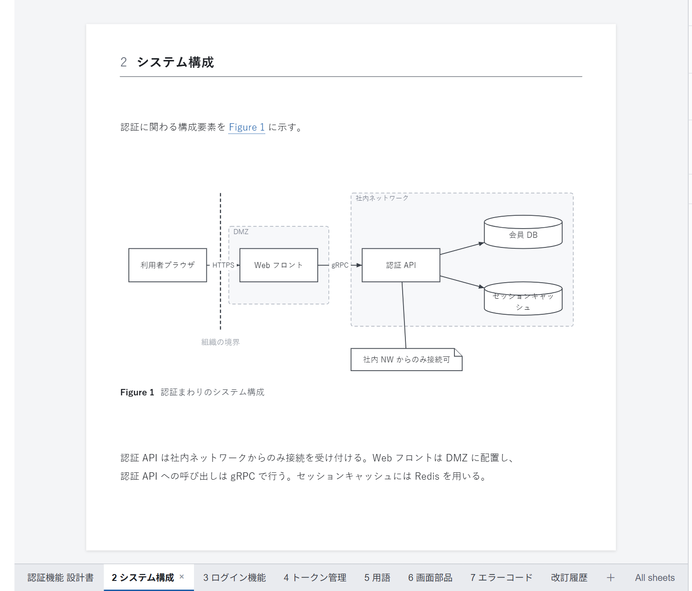
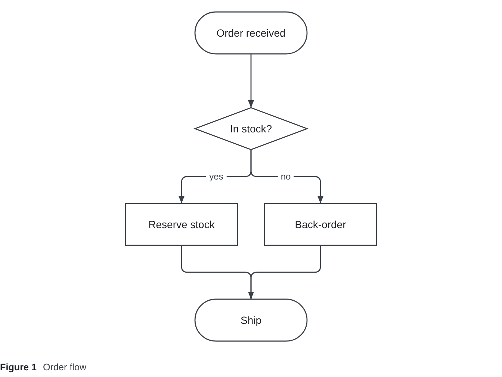
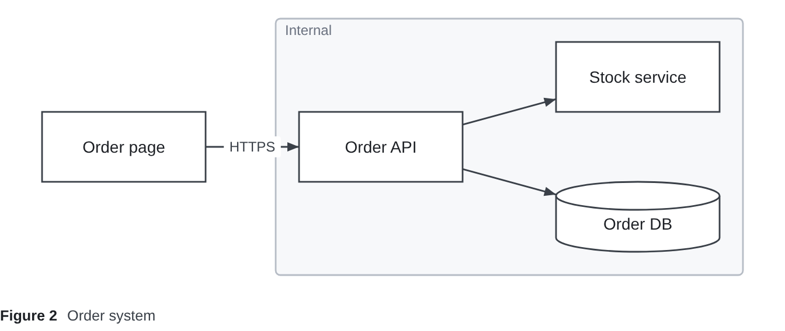
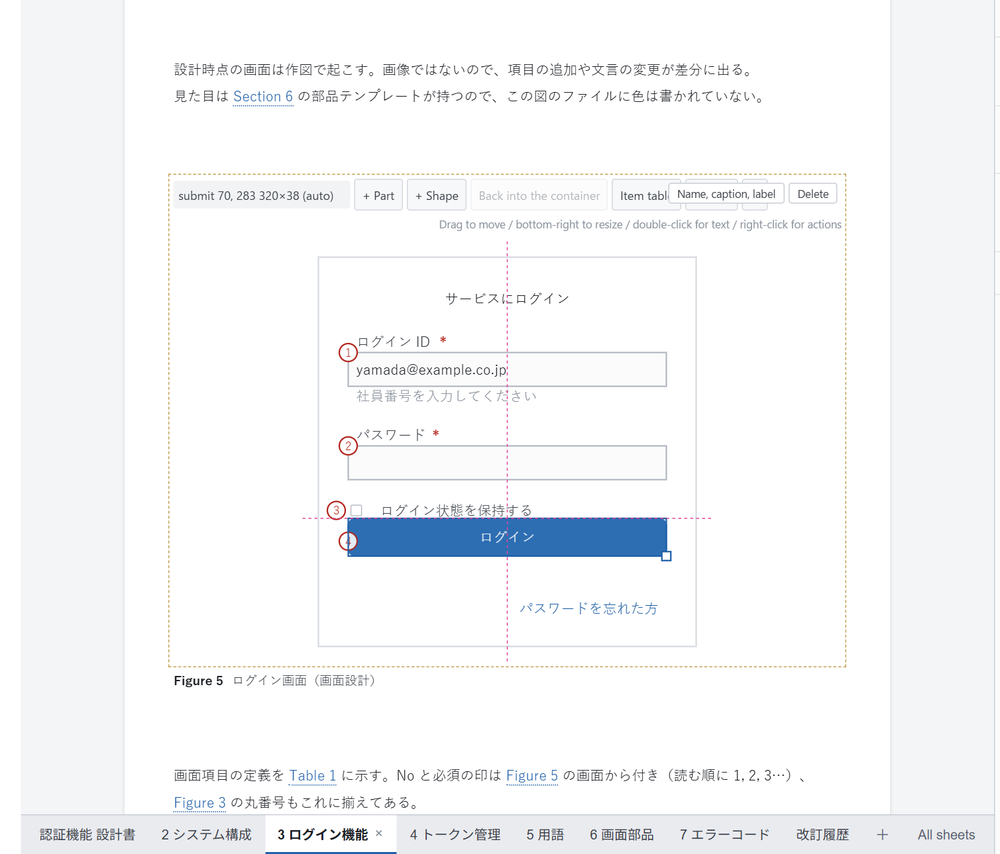
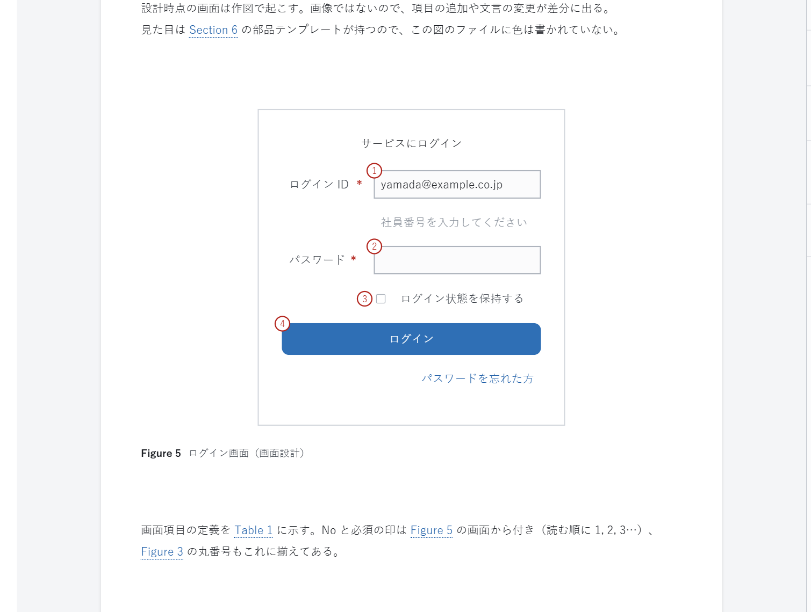
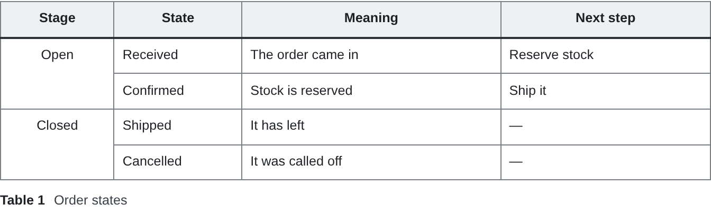
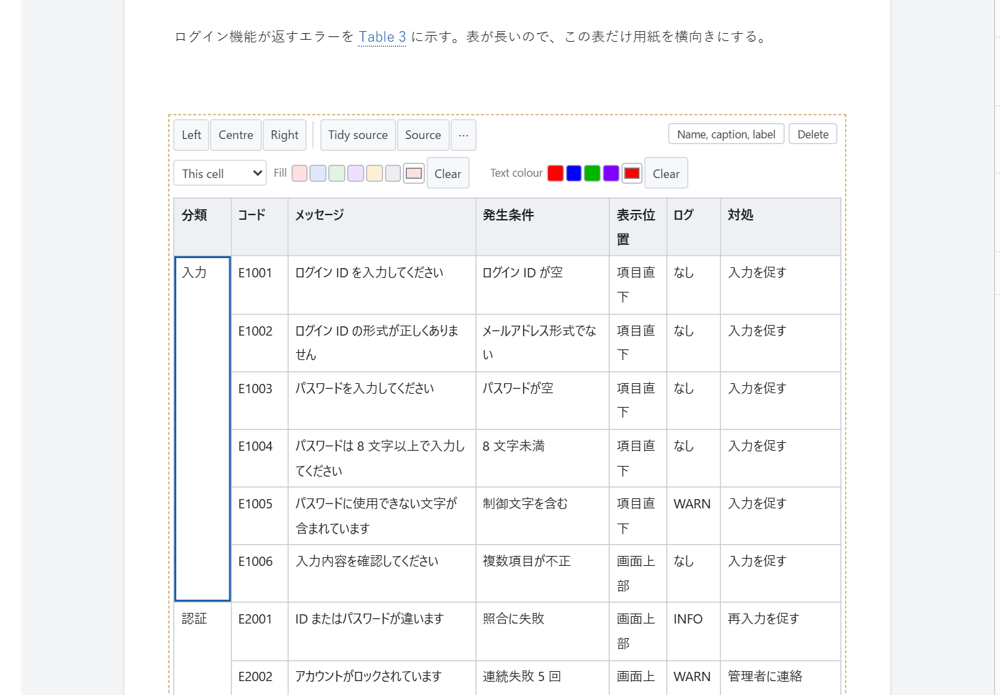
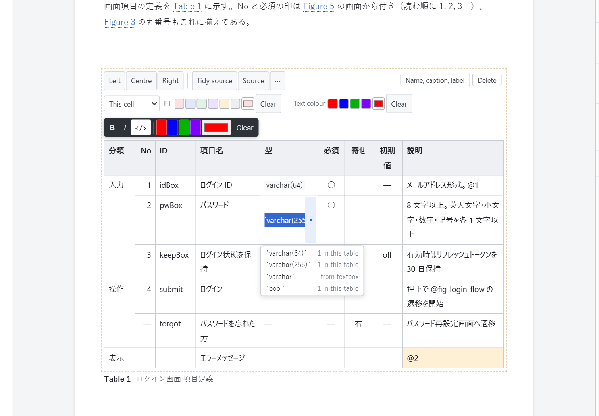

# DocPresenter (VS Code extension)

[日本語](https://github.com/Rintaro-Sugishita/DocPresenter/blob/HEAD/packages/app-vscode/README.ja.md)

Write software design documents in Markdown, draw their diagrams and tables as plain-text files, and edit all of it
**on the page as it will be printed**, right inside VS Code. Export to **HTML, PDF and editable PowerPoint (PPTX)**,
and keep every change reviewable as an ordinary Git diff.

Installing DocPresenter installs **DocPresenter Diagram** with it: the drawing side (`.dgm` files on their own, as
text or on a canvas, and as SVG). Inside a document, diagrams are drawn and edited by DocPresenter itself.



## What it does

Design documents kept in Excel, Word or draw.io cannot be reviewed in a pull request: the diff means nothing to a
person or to an AI. DocPresenter keeps the document as **text files in your repository** and does the rest:

| | |
|---|---|
| **Edit on the page** | Open a `.md` and it shows as printed pages. Type into paragraphs, move shapes, edit table cells. Each action is written back as **one small text change**, so the Git diff shows exactly what you changed and nothing else |
| **Draw** | Diagrams (flowcharts, state diagrams, system diagrams, screen sketches) are `.dgm` text files. Write the boxes and arrows; the layout is computed, and only what you move by hand is recorded |
| **Number and cross-reference** | Figures, tables and headings are numbered for you, references like `@fig-login` become "Figure 3", and a table of contents and cover are made |
| **Export** | One click gives HTML, PDF (fonts embedded) or PPTX (diagrams and tables stay editable in PowerPoint) |
| **Check** | Broken references and mistakes in diagrams and tables show up in the Problems panel |
| **Bring changes back** | Shapes moved or text fixed in the exported PowerPoint can be read back into the `.dgm` |
| **Take reviews from people without Git** | Customers annotate the PDF as usual; their comments are imported into a review file, tied to the exact words they marked, and your answers travel back in the next PDF |

## Diagrams and tables: write them as code, or draw them on screen

Diagrams (`.dgm`) and tables (`.table`) can be **written as text or edited on screen with the mouse**. Either way they
are the same single text file, and an edit on screen rewrites only the lines it changes, so people who prefer code and
people who prefer a canvas can work on the same files.

### Diagrams: flowcharts, and free-form drawings like PowerPoint

A `.dgm` comes in two kinds.

**flow**: write the shapes and how they connect; the layout is worked out for you. For processes, procedures and state changes.

```
flow {
  start   ([Order received])
  check   {In stock?}
  reserve [Reserve stock]
  backord [Back-order]
  ship    ([Ship])

  start   --> check
  check   --> reserve "yes"
  check   --> backord "no"
  reserve --> ship
  backord --> ship
}
```



**free**: shapes stay where you put them. For system diagrams and screen sketches, drawn the way you would in PowerPoint.

```
free {
  shop  [Order page]
  api   [Order API]
  stock [Stock service]
  db    [(Order DB)]

  group back "Internal" { api; stock; db }

  shop  -> api   "HTTPS"
  api   -> stock
  api   -> db
}

layout {
  shop  @ ( 40, 100) 140x60
  api   @ (260, 100) 140x60
  stock @ (480,  40) 140x60
  db    @ (480, 160) 140x60
  back  @ (240,  20) 400x220  z:-1
}
```



**On screen** (in a document, or "Open in DocPresenter Diagram" for a `.dgm` on its own)



- Drag shapes to move them and the bottom-right handle to resize; they snap to guides lined up with other shapes.
- Double-click to change text. "+ Shape" adds shapes; "+ Part" adds icons such as routers and servers, and screen parts such as buttons and inputs.
- Right-click to draw a line, group, delete, or hand a shape back to the automatic layout.
- Pick several shapes to line up their edges or centres, or spread them evenly.
- Drag the middle of a line to bend it and its end to reconnect it; choose the arrowheads and the weight.
- In a flow diagram, only the shapes you moved by hand are recorded; the rest stay laid out automatically.

**Screen designs: inputs with their labels, and the item table**



- An input added from "+ Part" comes with its label, ready for typing. The two move and are deleted together.
- Right-click "Put the labels on the left / on top" to move the labels of the whole form. On the left, the inputs line up, and dragging sets the label column's width.
- Renaming a label renames the item in the item table (`.table`) in the same single edit. Text inside an input is sample data and never becomes the item's name.

**As code** (opened as text)

- Opened as text in VS Code, a `.dgm` is coloured and offers suggestions as you type: shapes, parts, what to connect to, properties.
- Mistakes are shown in red and listed in the Problems panel.
- One shape is one line, so the diff says exactly what changed.
- The [format is published](https://github.com/Rintaro-Sugishita/DocPresenter/blob/HEAD/spec/dgm.md), so AI agents such as Claude Code can write it too.
- Shapes moved in the exported PowerPoint can be read back into the `.dgm`.

### Tables: a plain-text format, and a spreadsheet-like grid

Tables that outgrow Markdown (merged cells, column widths, colour) are written as `.table`.

```
| Stage    | State     | Meaning              | Next step     |
|:--------:|-----------|----------------------|---------------|
| Open     | Received  | The order came in    | Reserve stock |
| ^        | Confirmed | Stock is reserved    | Ship it       |
| Closed   | Shipped   | It has left          | —             |
| ^        | Cancelled | It was called off    | —             |

style {
  col:Stage { width: 16% }
  col:State { width: 18% }
}
```



**The text format**

- It reads like a Markdown table; `^` merges a cell with the one above.
- Column widths, fill and text colour go in a `style` section below the grid, so the grid stays readable.
- Cells can hold bulleted lists, and ranges can be named.
- One changed cell is one changed line in the diff. The [format is published](https://github.com/Rintaro-Sugishita/DocPresenter/blob/HEAD/spec/table.md).

**On screen**



- It works like a spreadsheet: click to select, move with the arrow keys, type to overwrite, Enter or Tab to commit and move on.
- Select a range with Shift+arrows or by dragging. Copy and paste to and from Excel and other spreadsheets.
- Right-click to add or delete rows and columns, and to merge or unmerge cells.
- Drag a column's edge to set its width. Set fill, text colour and alignment for a cell, a row, a column or the header.
- "Tidy source" lines up the text's columns; "Source" edits the `.table` directly.
- In an item table, the Type, Required and Align cells offer choices (Alt+↓ opens them). Types come from the words the tables use and from the parts on the screen. Space cycles Required and Align.



**Exchanging tables with Excel: through the clipboard**

Excel files (.xlsx) are neither imported nor exported. Cells go back and forth through the clipboard instead.

- **Excel → table**: copy a range in Excel or Google Sheets, pick a cell in the table and paste. The values land with
  that cell at the top left, and the table grows rows and columns as needed. The whole paste is one edit, so one undo.
- **Table → Excel**: copy (or cut) a range in the table; it goes to the clipboard as tab-separated text, which a
  spreadsheet pastes as cells. The header row can be part of the range; a position covered by a merge is left empty
  rather than repeating the value.
- A cell with a line break (Alt+Enter) or quotes in it travels as one cell. A table cell is one line, so a pasted line
  break becomes a space, and a `|` is written as the character `\|`.
- Formatting (colours, borders) does not travel: values only.

## The files

Everything is plain text you can read in a diff. The extension adds no hidden state.

| File | What it is |
|---|---|
| `.md` | The document: Markdown with a short frontmatter (`document:` number, `title:`, `output:` formats …). `@import "path"` takes in a diagram or table; `---` starts a new page (a slide in PPTX) |
| `.dgm` | A diagram. Shapes and connections, one per line (`login [Log in]`, `login --> home`). Opens as text with colouring and suggestions, or as a canvas with "Open in DocPresenter Diagram" (DocPresenter Diagram, installed with this extension). [Format](https://github.com/Rintaro-Sugishita/DocPresenter/blob/HEAD/spec/dgm.md) |
| `.table` | A table with merged cells, column widths and named ranges, for tables too complex for Markdown. Edited as a grid inside the document. [Format](https://github.com/Rintaro-Sugishita/DocPresenter/blob/HEAD/spec/table.md) |
| `.mmd` | A Mermaid diagram (sequence diagrams and the like). ` ```mermaid ` blocks in a `.md` work too |
| `.png` `.jpg` `.svg` … | Images, taken in with `@import` like any figure |
| `reviews/*.review.yml` | Review comments and answers, one file per round |
| `.docpresenter/` | Your team's templates, theme and writing guide (made by "Set Up This Folder") |

A typical layout: `docs/<name>.md` for each document, `docs/<name>/` for the diagrams and tables only it uses, and
`shared/` for those several documents use.

## Getting started

### 1. Set up the repository

Start here, once per repository: run **"DocPresenter: Set Up This Folder"**. After asking for a title, a file name and a
document number, it puts the following in place and opens the first document.
**Files that are already there are never overwritten** (they are reported as kept).

```
docs/<name>.md                 The first document (made from the template below): frontmatter, an overview, the revision history taken in
docs/<name>/revision.md        Its revision history
docs/assets/                   Where images go
shared/glossary.table          A glossary several documents can take in
.docpresenter/guide.md         The writing guide (for agents such as Claude Code)
.docpresenter/spec/            The formats of .dgm, .table and text inside labels
.docpresenter/templates/       Templates for new documents (document.md, revision.md). Change them to your team's format
.docpresenter/themes/default/  The theme (theme.css), a copy of the shipped one. Change it to your team's look
CLAUDE.md / AGENTS.md          A section telling agents to read guide.md is appended (the file is made if missing)
.gitignore                     The output folder (out/), *.pdf and *.pptx are appended (SVG and PNG are left in Git)
```

Appending happens once, so running the command again adds nothing.

### 2. Add a document

To add a document, run **"DocPresenter: New Document (numbered)…"** (or right-click a folder in the Explorer).
It asks for a title, the folder, a file name, **assigns a document number**, and makes the document and its
revision history from the templates (`.docpresenter/templates/`, below). The number is picked from the next free number of a series the repository
already uses (`SD-AUTH-` and so on); a new series or a number of your own also works, but a number in use is refused.
Review comments are tied to the document number, so **every document has one, and no two share one**
(the build warns otherwise).

### 3. Add a diagram

To add a diagram, run **"DocPresenter: New Diagram (flow or free)…"** (or right-click a folder). It asks for the kind
first — **flow** (laid out from its arrows: processes, procedures, state changes) or **free** (shapes stay where you put
them: system diagrams, screen sketches) — then the folder (each document's own folder first, then folders that already
hold diagrams, then `shared/`) and the name, and opens it. To show it in a document, choose it from "+ Reference" at the
end of the document.

### Folders

Documents can be split into folders as the application grows (`docs/order/design.md`, `docs/billing/design.md`, …).

- When making a document or a diagram, pick a folder from the list, type another (it is made if missing), or put a `/`
  in the name (`order/design`).
- File names may use upper case, spaces and Japanese. Only what some platform refuses is refused:
  `\ : * ? " < > |`, a leading space, a trailing space or period, and names Windows keeps (`CON`, `NUL`, …).
- `@import` paths are relative to the document, so a document finds its figures however deep it sits. The templates'
  `{{root}}` is the way up to the workspace root (`../../` from `docs/order/design.md`), so `{{root}}shared/` always reaches `shared/`.
- **Exports keep the folders**: `docs/order/design.md` goes to `out/build/docs/order/design.html`, the same folders as the workspace, so two
  `design.md` in two folders never write over each other.
- Document numbers are unique across the whole repository, whatever folder a document is in.

### Your team's templates and theme

The templates and theme set up by the command are **files in your repository**: change them and commit them.

- **Templates** (`.docpresenter/templates/document.md`, `revision.md`) are used every time a new document is made.
  The placeholders are `{{title}}`, `{{number}}` (the document number), `{{name}}` (the file name without its
  folder, used to take in the revision history), `{{today}}` and `{{root}}` (the way up to the workspace root). A placeholder that is a whole frontmatter value is written as valid YAML
  (a title containing `:` is quoted). Even when a template has no `document:`, the assigned number always goes into
  the frontmatter. Without the files, the shipped templates are used.
- **Themes** are looked for in `.docpresenter/themes/<name>/theme.css`, then `themes/<name>/theme.css`, then the
  shipped theme (`<name>` is the frontmatter's `theme:`, `default` when absent). The theme found is used for exports
  (HTML, PDF) and for the editor's screen; saving it shows the change in the editor at once.

## Opening

- Right-click a `.md` in the Explorer → **"Open in DocPresenter"**, or use the button at the top right of the editor.
  A document opens as a row of sheets; diagrams and tables are edited in place.
- A `.dgm` on its own opens on DocPresenter Diagram's canvas: right-click it → **"Open in DocPresenter Diagram"**.
- Every edit is written back as **one byte range per action**. Undo, the unsaved dot and the Git diff all work as usual,
  because edits are handed to VS Code as a `WorkspaceEdit`.
- On the screen, **Ctrl+Z undoes and Ctrl+Y (Ctrl+Shift+Z) redoes**. Diagrams and tables live in files of their own,
  which VS Code's undo does not reach; the screen's undo takes those back too, again as one edit.
  A file changed elsewhere since is never written over.

### Writing a document as text

The same help in DocPresenter's text box (click a paragraph) and in VS Code's own editor for a `.md`:

| Key | What it does |
|---|---|
| **Enter** on a list item | Starts the next item with the same bullet, the next number, an empty task box. Enter on an empty item ends the list |
| **Tab / Shift+Tab** on list items | Moves the items one level in (under the item above) or out. Elsewhere, Tab is Tab |
| **Ctrl+B / Ctrl+I / Ctrl+E** | Bold, italic, code (pressed again, taken off) |
| **`@`** | Offers the labels the document can refer to (its included documents' too), with their numbers and captions |
| **`@import "`** | Offers the drawings, tables and other files there are, written from the document |

In VS Code the keys can be turned off with the setting `docpresenter.markdownEditing` — when another Markdown extension already does the same.

### Writing and formatting a `.dgm`

Drawings are the business of **DocPresenter Diagram**, which is installed with this extension: colouring and
suggestions as you type, formatting, the canvas for a `.dgm` on its own, and SVG export. See its
[README](https://github.com/Rintaro-Sugishita/DocPresenter/blob/HEAD/packages/app-vscode-diagram/README.md).

## Renaming figures and tables

Hover over a figure or table and **"Name, caption, label"** appears at its top right (right-clicking a figure does the same).
All three can be changed at once.

| What you change | What is rewritten |
|---|---|
| **File name** | The file is renamed within its folder, and the `@import` lines of **this and every other document** point to the new name. The folder and extension stay |
| **Caption** | `caption="…"` on the `@import` line. The number (Figure 3 etc.) is added in front automatically. Empty removes the caption |
| **Label** | `#fig-…` on the `@import` line and **every `@fig-…` in the text**. Figures start with `fig-`, tables with `tbl-` |

- Only the lines that carry the name change, and the document is written back as one edit (one undo). The other documents' changes and the rename go into one `WorkspaceEdit`.
- Names that cannot be used (a label already used in the document, removing a label the text refers to, an existing file name, …) are refused with the reason.
- References are fixed **only within this document**. References from another document as `@doc:label` are not.
- Lines inside a `.dgm` that point to other files (`overlay` images, part libraries) are not fixed.

## Edit and Read (review)

Switch with **"Edit / Read (review)"** at the top of the screen (remembered per editor).

- **Read (review):** clicking the text does not start editing, so text can be selected. Selecting shows
  **"Add a comment"**; the comment is appended to a review file (`reviews/*.review.yml`). The first time, you are asked
  which review file to use. A list of the comments on this document is shown beside the page; click one to go to it.
- **Edit:** comments are marked **where they are now**. Hover to see the comment, its answer and status.
  Turn the marks off with **"Comment marks"** at the top when they get in the way.
- Where the text has changed since the comment, the mark is dotted and says so. Comments whose place can no longer
  be found stay in the list.
- **Status and answer:** in the list in Read mode, choose each comment's status (Open / Resolved / Won't fix / Question)
  and write an answer with "Write an answer". Only that comment's `status:` and `reply:` lines in the review file change.
  The answer goes into the next PDF you export.

## Exporting

| What you want | How |
|---|---|
| The open document, in one format | **"Export: HTML / PDF / PPTX"** above the document. The "…" menu at the editor's top right and commands such as "DocPresenter: Export This Document as PDF" do the same |
| Every document with `output:`, as each one says | **"DocPresenter: Export Every Output (as each document's output: says)"** |
| Every document with `output:`, in formats you choose | **"DocPresenter: Export Every Output in Formats of My Choice…"** (choose from HTML / PDF / PPTX; this overrides `output:`) |

- Exports go to `out/build` (set `docpresenter.outDir` to change it), keeping the workspace's folders (`docs/order/design.md` → `out/build/docs/order/design.pdf`).
- PDF pages are laid out by DocPresenter's own screen. When exporting several documents, a "DocPresenter export" panel
  opens beside the editor and closes when done. Fonts installed on this PC are embedded
  (on Windows, Yu Gothic, and MS Gothic for code).

## Reading diagrams changed in PowerPoint back

Diagrams exported to PPTX can be **read back into the original `.dgm`** after they have been changed in PowerPoint.

1. Right-click the `.pptx` in the Explorer → "**Read PPTX Changes Back into the Diagrams…**" (also in the Command Palette, where you choose the file)
2. The diagrams that would change are listed. The lines that would change are shown with `-` / `+` in the Output panel; check them, then choose
3. The chosen diagrams are rewritten **only where they changed**, and saved. Undo and the Git diff work as usual

| Change in PowerPoint | Read back |
|---|:--:|
| A shape moved or resized | ✓ (the one line with that shape's position) |
| A shape's text changed | ✓ (that shape's line. Bold and other formatting are dropped, with a warning) |
| A shape added, a line reconnected | ✗ (a warning says so) |
| A line's label changed | ✗ (a warning says so. Change it in the diagram) |
| A table changed | ✗ (a warning names the table. Change the `.table` or the Markdown table) |
| Body text changed | ✗ (only diagrams are read back) |

- If a diagram changed between reading and writing (unsaved changes included), it is not written, and its name is given.
- Checked with decks saved again in real PowerPoint (Microsoft 365).

## Importing comments written on a PDF

An exported PDF carries, as an attachment, where each line came from (which file, which place). When a customer returns
the PDF with annotations (highlights, sticky notes, …), they can be **imported into the review files (`reviews/*.review.yml`)**.

1. Right-click the `.pdf` in the Explorer → "**Import PDF Annotations as Review Comments…**" (also in the Command Palette).
   **Several PDFs can be imported at once**: each PDF knows which document it is (its path and document number)
2. Where each annotation goes is shown in the Output panel. Choose the review file to import into: a new one or an existing one
3. The comments are appended. Earlier lines are not changed, and the same annotation never goes in twice

| Annotation | Where the comment points |
|---|---|
| Highlight or underline on words | **Those words** (inside the `.dgm` / `.table` when in a figure or table) |
| Sticky note, box | The whole paragraph, figure or table |
| Nothing under it (a margin, …) | No place (kept as `status: orphaned`) |

- Each comment carries the commit the PDF was exported from. A PDF exported with uncommitted changes gets `uncommitted: true`.
- **Answers travel in the PDF.** An exported PDF has the comments on that document as annotations (a highlight on the
  words), with the status and answer (`reply:`) in the annotation's text. The customer reads the answer in the PDF and
  replies to the annotation (or writes below it). On import, replies go **under the original comment** in `replies:`,
  and the comments and answers we put in the PDF are not imported again.
- For a PDF that should carry no comments (a copy to deliver), turn off the setting `docpresenter.pdfReviewNotes` before exporting.

## Code and Mermaid

- Code blocks are coloured by their language name (` ```sql ` and so on), which is shown above the block. On
  DocPresenter's screen, **"Copy"** beside it copies the whole block.
- ` ```mermaid ` blocks and `.mmd` files become diagrams. Hover over the block and **"Diagram / Code / Both"** appears at
  its top right. Choosing writes `{view="…"}` into the file, and exported HTML, PDF and PPTX follow it.

### Languages that are coloured

The language name on the opening line (aliases work too). Other names are not coloured, and shown above the block as written.

| Language | Names |
|---|---|
| Bash / shell | `bash` `sh` `zsh` `shell` `console` |
| PowerShell | `powershell` `ps` `ps1` |
| JavaScript | `javascript` `js` `jsx` `mjs` `cjs` |
| TypeScript | `typescript` `ts` `tsx` `mts` `cts` |
| JSON | `json` |
| YAML | `yaml` `yml` |
| XML / HTML / SVG | `xml` `html` `xhtml` `svg` |
| CSS | `css` |
| SQL | `sql` |
| Python | `python` `py` |
| Java | `java` |
| Kotlin | `kotlin` `kt` |
| C# | `csharp` `cs` `c#` |
| Go | `go` `golang` |
| Diff | `diff` `patch` |
| INI / TOML | `ini` `toml` |
| Dockerfile | `dockerfile` `docker` |
| Markdown | `markdown` `md` |
| Text (no colour) | `plaintext` `text` `txt` |
| Mermaid (becomes a diagram) | `mermaid` |

## Display language

**It follows VS Code's display language.** Japanese when VS Code is in Japanese, English otherwise (command names,
setting descriptions, notifications, the editor, and the cover and contents of exported documents). Change it with
VS Code's "Configure Display Language"; the extension has no setting of its own.

- The first document, the glossary and the `CLAUDE.md` section written by "Set Up This Folder" are in that language too
  (`.docpresenter/guide.md` is Japanese only for now).
- This page is in English whatever the display language: VS Code shows one README for every language.
  The Japanese version is linked at the top.

## Not in this version

| | |
|---|---|
| **Exporting PDFs in bulk** | A bulk build has no screen to lay pages out, so PDFs are exported one document at a time with the button |
| **Editing Mermaid in PowerPoint** | Mermaid diagrams go in as images. Draw with `.dgm` to get shapes you can move in PowerPoint |
| **Editing part libraries** | Parts can be chosen on screen, but the parts themselves are written in source |
