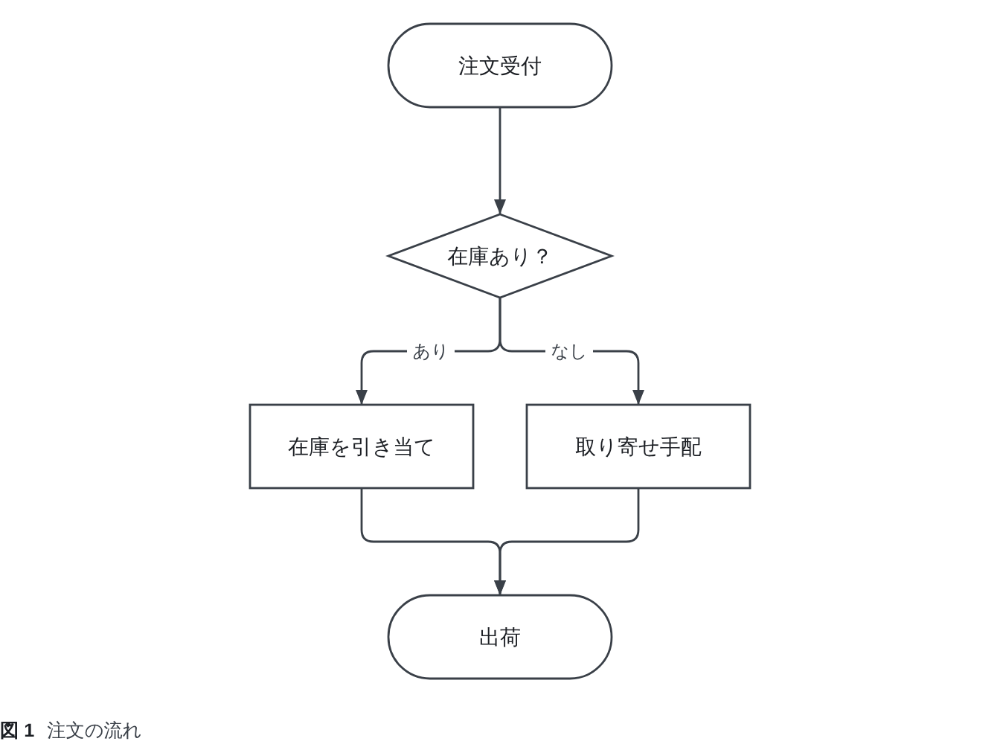
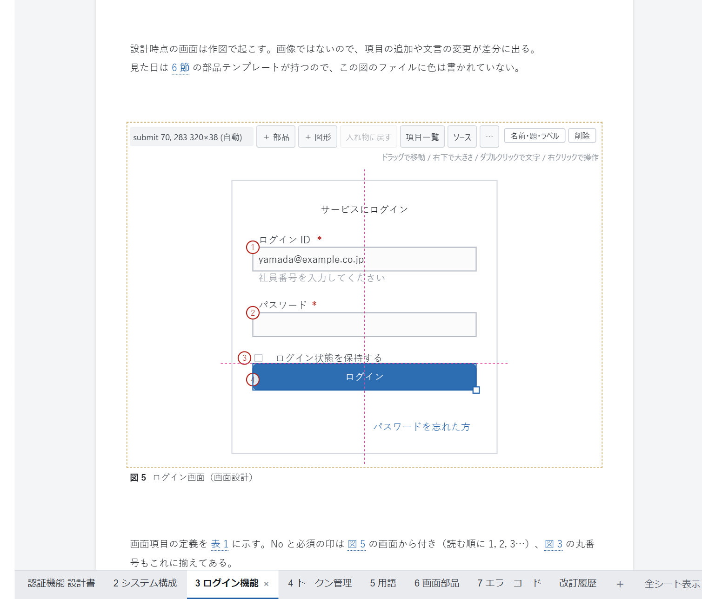
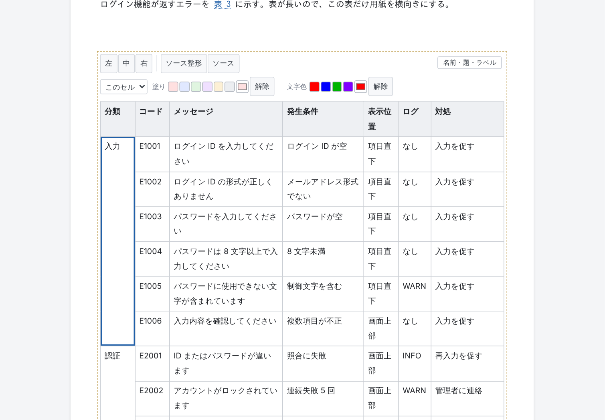
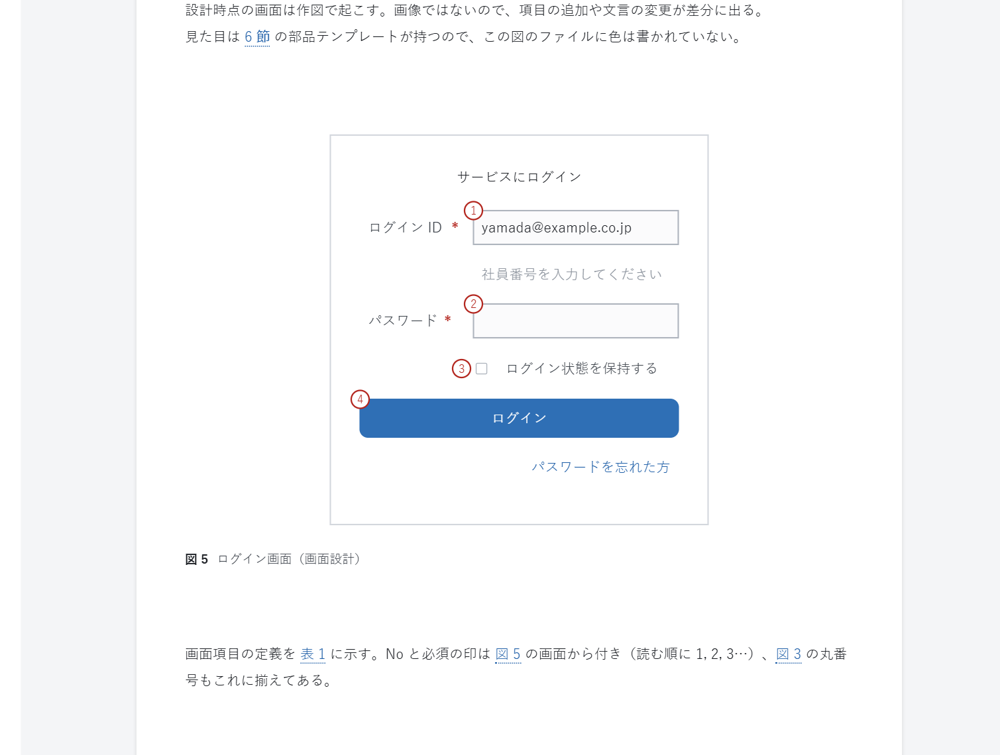
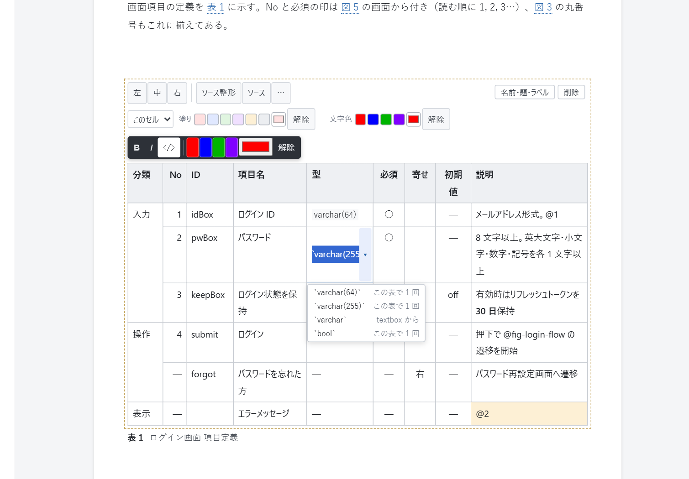

# はじめに

設計書のレビューが、とにかく大変でした。

改訂版の設計書が届いても、前の版のどこが変わったのかが分かりません。変更履歴の表や赤字はありますが、手で付けたものなので漏れがあり、結局は全部読み直すことになります。

もうひとつ困ったのが、ファイルサーバーに置かれた Excel の設計書に、いつの間にか見覚えのない記述が増えていたことです。誰が、いつ、どういう意図で書いたのかを追う手段がありませんでした。

ソースコードなら、どちらも困りません。プルリクエストの差分を見ればどこが変わったか分かりますし、`git log` や `git blame` をたどれば、誰がいつ変えたかがコミットメッセージ付きで分かります。

ソースは差分でレビューしているのに、設計書ではそれができない。これをなんとかしたくて、設計書を Git で管理してレビューするための VS Code 拡張「DocPresenter」を作りました。この記事では、何に困って、どう考えて、何を用意したかを順に書きます。

# Git に載せるだけでは足りない

設計書の Excel ファイルをそのままリポジトリに入れても、ほとんど何も解決しません。差分がバイナリなので読めず、2 人が同時に直せば片方の変更を手で移すことになります。

そこで、次の 2 つを条件にしました。

**差分が読めて、マージできる形式にする**
本文・図・表をすべて行単位のテキストで持ち、XML や画像にはしません。テキストなら、別々の箇所を直した 2 人の変更は Git が自動でマージできるので、競合しにくくなります。人が差分を読めるのと同じ理由で、AI も少ないトークンで読み書きできます。

**書き手を選ばない**
Excel が設計書に使われ続けているのには理由があります。セルを選んで打つだけで書け、表も画面も思った位置に置けることです。これは捨てたくありませんでした。テキストを直接書きたい人も、Excel のように画面で触りたい人も、同じファイルを扱えるようにします。チーム全員が Git を使える前提にもしていません（後半で触れます）。

前半ではこの条件で設計書をどう表現したか、後半ではレビューや顧客への提出で起きる問題にどう対処したかを書きます。

# 前半：設計書を、差分が読めるテキストで表現する

## 既存のツールを検討した

自作する前に、既存のツールで条件を満たせないかを検討しました。あくまで「自分の用途では」の結論です。

| 候補 | 検討の結果 |
|---|---|
| Markdown の表 | 書式は使いやすいが、設計書で多い結合セルや列幅の指定がない |
| draw.io | 描きやすいが、中身が XML なので差分が読みにくく、マージもしにくい |
| Mermaid（フローチャート） | ひし形が正方形で描かれるため、分岐の多いフローが縦に長くなった |
| Mermaid（シーケンス図） | 十分に使える。**そのまま採用した** |
| PlantUML | 動かすのに Java が要る |
| D2 | 動かすのに Go 製の別バイナリが要る |
| ER 図 | 専用ツールの領域と判断した |

シーケンス図は Mermaid をそのまま使い、ER 図は ErCreator（拙作）などの専用ツールで描いたものを取り込む形にしました。作ったのは、既存のツールでは条件に合わなかった部分だけです。

## 本文は Markdown のまま、足りない部分だけ文法を足した

本文は既にある書式で十分だったので、新しく作りませんでした。足したのは、Markdown では表せない図と表のための形式です。どちらも本文と同じく、行単位のテキストです。

```
docs/
  auth-design.md          本文（Markdown）。図や表を取り込み、--- で改ページ
  auth-design/
    login-flow.dgm        図
    screen-items.table    結合セルのある表
reviews/*.review.yml      顧客レビューの指摘と回答
```

図・表・章の番号は、ファイルに書かずに出力時に振ります。図を 1 つ足しても、後ろの図の番号や「図 3 参照」の行に差分が出ません。

## フローチャートは、つながりだけ書けば配置が決まる

フローチャートは、図形とつながりを書けば配置が自動で決まる `flow` という形式で書きます。ひし形は文字に合わせた横長になるので、分岐が続いても縦に伸びすぎません。

```
flow {
  start   ([注文受付])
  check   {在庫あり？}
  reserve [在庫を引き当て]
  backord [取り寄せ手配]
  ship    ([出荷])

  start   --> check
  check   --> reserve "あり"
  check   --> backord "なし"
  reserve --> ship
  backord --> ship
}
```



## 置いた場所に描きたい図は、マウスで描いても 1 行しか変わらない

構成図や画面イメージのように「置いた場所に描きたい」図は、テキストだけでは書きにくいものです。かといって、GUI の作図ツールは保存のたびにファイル全体が書き換わり、差分が読めなくなりがちです。

そこで、キャンバス上でマウスで描けるようにしたうえで、**画面での 1 操作はファイルの 1 か所の書き換えにする**、と決めました。図形を 1 つ動かすと、変わるのはその図形の位置の 1 行だけです。そのため、VS Code の元に戻す・未保存の表示・Git の差分がそのまま使えます。



これを成り立たせるために、**自動で決まる座標はファイルに書かない**ようにしています。`flow` の図では、手で動かした図形の位置だけを記録し、それ以外は表示のたびに自動配置します。自動配置の結果まで保存すると、1 つ図形を足しただけで全部の座標がずれて差分が埋まってしまうからです。

テキストで書いた人とマウスで描いた人の変更が同じファイルに並ぶので、どちらの書き方でも同じようにレビューできます。

## 表は Markdown の見た目のまま、Excel のように編集できる

結合セルや列幅が要る表は `.table` で書きます。見た目は Markdown の表のままで、`^` と書けば上のセルと結合します。

```
| 区分   | 状態     | 意味             |
|:------:|----------|------------------|
| 進行中 | 受付     | 注文を受け付けた |
| ^      | 確定     | 在庫を引き当てた |
| 終了   | 出荷済み | 出荷した         |
```

テキストで書くのがつらい人のために、画面ではグリッドとして開けるようにしました。矢印キーで移動して入力し、範囲選択や行・列の追加、セルの結合ができます。Excel やスプレッドシートとの間でコピー・貼り付けもできます。



## 画面設計は、方眼紙でも画像でもなく、項目一覧とつながった形で書く

画面設計書は、差分の読めなさが一番目立つところでした。画面イメージは Excel 方眼紙のセルで描くか、スクリーンショットを貼るかのどちらかで、どちらも差分になりません。さらに、画面イメージと項目一覧（項目名・型・必須・寄せ）を別々に管理しているので、片方だけ直されてずれていきます。

画面イメージと項目一覧は、同じ情報を別の形で見せているだけです。そこで、画面も `.dgm` のテキストで持ち、項目一覧とつなげることにしました。

- 入力欄はラベルと組で置けます。ラベルを上に置くか左に置くかを切り替えられ、左に置くと入力欄の位置がそろいます。
- ラベルを書き換えると、項目一覧の項目名も同じ 1 回の操作で変わります。
- 項目一覧の「型」「必須」「寄せ」のセルには候補が出ます。型の候補は、部品の種類（テキストボックスなら varchar など）と、ほかの表で使われている語から出します。





# 後半：レビューと顧客への提出で起きる問題

## 「どこが変わったか」は、出力するときに Git の差分から付ける

チームの中のレビューなら、ここまでの形式でプルリクエストの差分をそのまま読めます。困るのは、改訂版を PDF などで顧客に出すときです。変更箇所を手で赤字にすると、塗り忘れれば差分と食い違い、次の版では剥がし忘れます。

どこが変わったかは、Git がもう知っています。そこで、**印はソースに書かず、出力するときに前の版との差分から付ける**ことにしました。比べる版（コミット・タグ・ブランチ、または Git を使っていない相手から受け取ったフォルダ）を選んで出力すると、変わった箇所に印が付きます。ソースには何も書き込まないので、印を剥がす作業もありません。

ここでも、図と表をテキストではなく**モデルとして比べている**ことが効いています。

- 本文は行単位で比べ、変わった段落に網掛けと左の帯を付けます。白黒で印刷しても位置が分かります。
- 表はセル単位で比べるので、変わったセルだけに印が付きます。行の比較だと、1 セル直しただけで行全体が変わったことになります。
- 図は図形とつながりの単位で比べるので、ラベルが変わった図形だけに印が付きます。
- 図形の位置の違いは見ません。図を見やすく整えただけの人が「内容を書き換えた」ことにされないためです。

<!-- TODO: 変更箇所付き出力のスクリーンショット（6-changes.png）を用意して差し替える -->

同じことを CLI からもできるようにして、CI で「前回のリリースからの変更箇所付き PDF」を作っておけるようにする予定です。

## 顧客のレビューは、PDF の注釈で受け取る

顧客に Git を使ってもらうのは現実的ではありません。そこで、顧客にはいつもどおり PDF に注釈を書いてもらい、それを取り込む形にしました。

出力した PDF には、各行がどのファイルのどの位置から来たかを埋め込んであります。注釈付きの PDF を取り込むと、ハイライトした語句がソースのどこに当たるかを特定して、指摘として `reviews/*.review.yml` に記録します。指摘はソースの位置と引用文で記録するので、版が進んでも該当箇所を追いかけられます。回答は次に出力する PDF に注釈として載るので、顧客はそこに返信して送り返せます。

指摘と回答もテキストでリポジトリに入るので、「この記述はどの指摘を受けて直したのか」も Git の履歴から追えます。

## 提出物は、ソースからいつでも作り直せるものとして扱う

最終的に顧客へ渡すのは PDF や PowerPoint です。ここでは、**ソースだけを正とし、出力物はいつでも作り直せるもの**として扱っています。出力のたびにソースが書き換わることはないので、出力しただけで差分が汚れることもありません。

- HTML・PDF・PPTX に出力できます。番号を振り、`@fig-…` のような参照を「図 3」に置き換え、目次と表紙も作ります。
- PDF はフォントを埋め込み、長い表は複数ページに分けます。
- PPTX の図と表は、PowerPoint で編集できる図形と表として出ます。PowerPoint で図形を動かした変更は、元の `.dgm` に読み戻せます。

# 割り切ったこと

- **顧客は PDF にコメントできますが、直接編集はできません。** 顧客にも Git やエディタを使ってもらう形と迷いましたが、相手の負担を増やさないことを優先しました。ここはかなり割り切った点です。
- **ER 図とシーケンス図は作っていません。** シーケンス図は Mermaid、ER 図は専用ツールに任せています。
- **編集は VS Code が前提です。** ほかのエディタでは、テキストを直接書くことになります。閲覧だけなら、下の Web ページで足ります。
- **Excel のような計算式はありません。**
- **オープンソースではありません。** ソースは公開していますが、ライセンスは独自のものです。

# 試してみる

- **インストールせずに見る**：[サンプルの設計書を開く](https://rintaro-sugishita.github.io/DocPresenter/view.html?src=https://github.com/Rintaro-Sugishita/DocPresenter/blob/main/sample/docs/auth-design.md)（GitHub 上の `.md` を `view.html?src=<ファイルの URL>` で開けます）
- **VS Code で書く**：
  1. Marketplace から [DocPresenter](https://marketplace.visualstudio.com/items?itemName=rintaro-sugishita.docpresenter) をインストール（作図の拡張 DocPresenter Diagram も一緒に入ります）
  2. コマンドパレットで「DocPresenter: 作業場を初期化する」
  3. できた `.md` を開いて「DocPresenter: この文書を開く」
- **形式の仕様**：`.dgm` と `.table` の仕様は[公開しています](https://github.com/Rintaro-Sugishita/DocPresenter/tree/main/spec)。作業場を初期化すると、AI エージェント向けの書き方ガイドも用意されます。

# おわりに

ソースコードでは当たり前の「差分でレビューする」「履歴から経緯を追う」を、設計書でもできるようにしたかった、というのがこのツールの出発点です。同じことで困っている方の参考になれば嬉しいです。

感想や不具合の報告は [GitHub の Issues](https://github.com/Rintaro-Sugishita/DocPresenter/issues) にお願いします。ライセンスは[リポジトリ](https://github.com/Rintaro-Sugishita/DocPresenter)をご覧ください。
