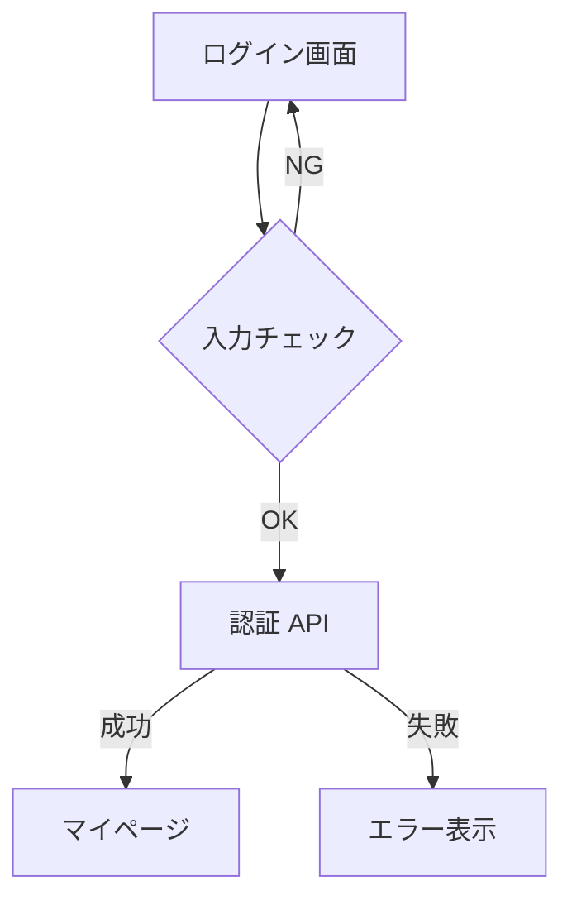
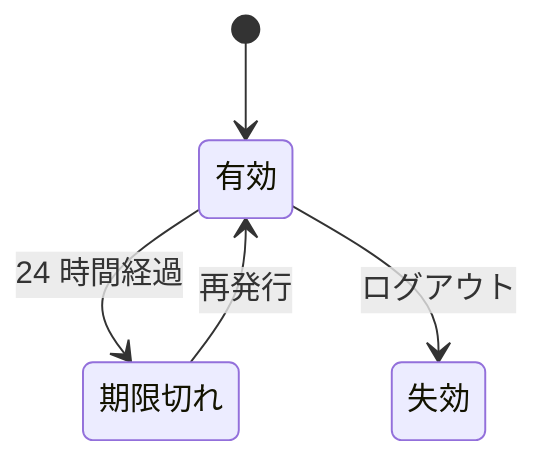
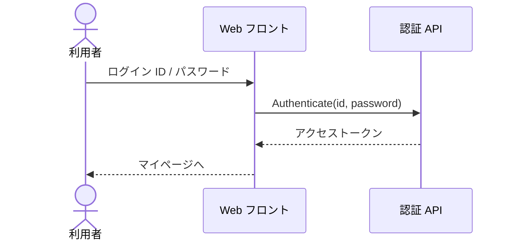

# コードと Mermaid の書き方

設計書に**コード**と **Mermaid の図**を載せる書き方の見本である。
どちらも Markdown の「コードブロック」（```` ``` ```` で囲む）で書く。

---

## コードの色付け {#sec-highlight}

コードブロックの最初の行に言語名を書くと、その言語として色が付く。
言語名を書かなければ、書いたとおりに表示される。

```typescript
// トークンの有効期限を確かめる
export function isExpired(token: AccessToken, now: Date): boolean {
  const limit = token.issuedAt.getTime() + 24 * 60 * 60 * 1000;
  return now.getTime() >= limit;
}
```

```sql
-- 5 回続けて失敗した会員をロックする
UPDATE member
   SET locked_at = CURRENT_TIMESTAMP
 WHERE failed_count >= 5
   AND locked_at IS NULL;
```

`#` で始まる行も、コードブロックの中では見出しにならない。

```bash
# 設計書をビルドする
node tools/build.mjs --in sample
```

`---` も、コードブロックの中ではシートの区切りにならない。

```yaml
---
auth:
  lock_after: 5        # 連続失敗の回数
  token_ttl: 24h
```

使える言語: `bash` `shell` `powershell` `javascript` `typescript` `json` `yaml`
`xml`（HTML も） `css` `sql` `python` `java` `kotlin` `csharp` `go` `diff` `ini`
`dockerfile` `markdown`。`ts` `yml` `py` などの別名も使える
（一覧は `packages/app-vscode/README.md` の「色が付く言語」）。

コードブロックの上には言語名が出る。DocPresenter の画面では、その横の「コピー」で全文をコピーできる。

---

## Mermaid を図として見せる {#sec-mermaid-diagram}

言語名を `mermaid` にすると、図として表示される。何も指定しなければ図になる。



---

## Mermaid をコードとして見せる {#sec-mermaid-code}

`{view="code"}` を付けると、図ではなくコードを表示する。
記法そのものを説明したいときに使う。



---

## 図とコードを並べる {#sec-mermaid-both}

`{view="both"}` を付けると、図の下にコードを並べる。



---

## 別ファイルの Mermaid {#sec-mermaid-file}

別のファイル（`.mmd`）に書いた Mermaid も、`@import` の行に同じ指定ができる。

@import "auth-design/login-sequence.mmd" {#fig-sample-sequence caption="ログイン処理シーケンス（別ファイルの Mermaid）" view="both"}

---

## 見せ方の切り替え {#sec-mermaid-switch}

VS Code の DocPresenter の画面では、Mermaid のブロックにマウスを載せると右上に
**「図 / コード / 両方」** の切り替えが出る。押すと、上の `{view="…"}` が
ファイルに書き込まれる。HTML・PDF・PPTX も、その指定どおりに出力される。

| 指定 | 表示 |
|------|------|
| （なし） | 図 |
| `{view="code"}` | コード |
| `{view="both"}` | 図とコード |
